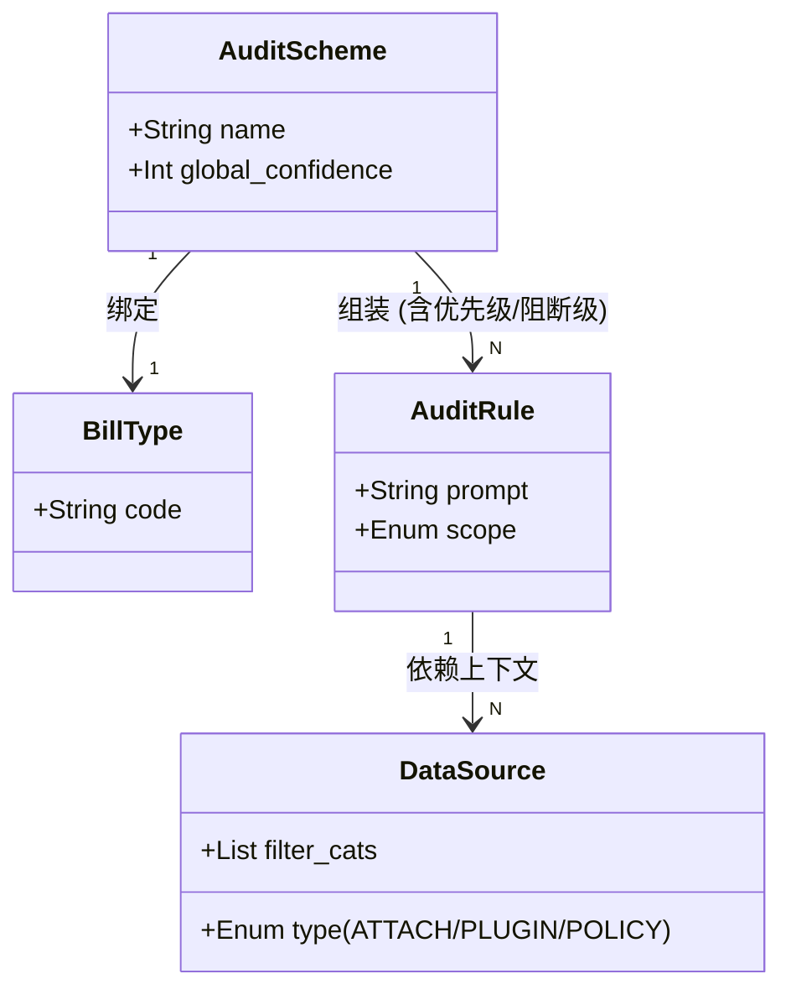
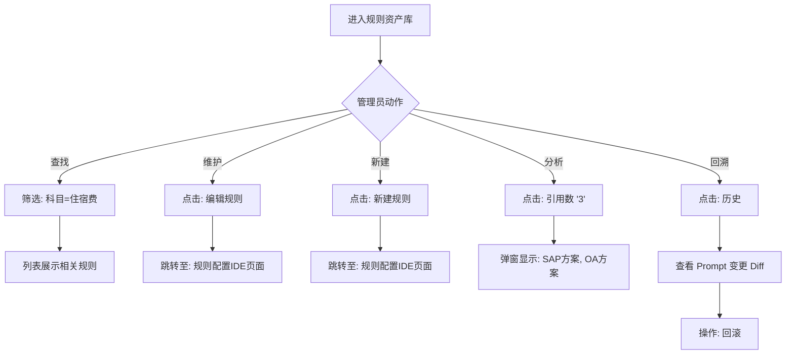

# 智能财务合规平台 - 功能与界面设计文档 V2.1 (插件形态版)

## 1. 核心交互模式

1. 审核员登录 **SAP/用友/OA** 打开一张待审批单据。
2. 浏览器插件自动识别并激活，以 **悬浮胶囊** 或 **侧边抽屉** 形式展示。
3. 插件自动抓取当前页面数据 + 调用后端进行 AI 审核。
4. 插件直接给出“通过/拒绝”建议。
5. 审核员在插件上点击“确认风险”或“强制通过”，然后继续在原系统点击“同意”按钮。

---

## 2. 功能清单 (Functional List)

我们将功能分为 **A. 插件端 (审核员专用)** 和 **B. 管理后台 (管理员专用)**。

### A. 浏览器插件端 (Browser Extension) - 审核员的工作台

这是用户感知最强、交互最频繁的界面。

| 模块 | 功能点 | 说明 | 数据交互逻辑 |
| --- | --- | --- | --- |
| **环境感知** | **自动激活** | 监测 URL，匹配 `ai_plugin_config` 正则，匹配成功则图标变亮并展开悬浮窗 | 本地正则匹配 |
| **数据采集** | **DOM 抓取** | 根据配置策略抓取单号、金额、申请人、明细行数据 | 执行 `ai_plugin_extract_rule` |
|  | **静默提交** | 将抓取的数据 + 当前页面 URL 发送给后端进行审核 | API: `/submit` |
| **结果展示** | **状态胶囊** | 悬浮在页面右下角的简略状态（处理中/安全/风险/阻断） | WebSocket / 轮询 Report |
|  | **审核面板** | 点击胶囊展开侧边栏，展示完整的红绿灯结果 | 渲染 `ai_audit_report` |
| **风险详情** | **风险定位** | 列出所有 Warning/Block 项，点击某一项展开详情 | 读取 `item_result` |
|  | **证据溯源** | 弹窗展示该风险对应的 **发票切片图** vs **填报数据** | 展示 `evidence_snapshot` |
|  | **规则解释** | 展示 AI 给出的自然语言判语（如：住宿费超标，标准500，实报800） | 展示 `fail_reason` |
| **人工干预** | **强制通过** | 针对 Warning/Block 项，允许点击“忽略风险”，填写备注后置为通过 | API: `/audit/override` |
|  | **反馈误报** | 标记 AI 判错，将当前快照发送给管理员用于优化 Prompt | API: `/audit/feedback` |
| **辅助工具** | **合规问答** | (可选) 内嵌 Chat 窗口，询问“这笔费用能不能报？” | RAG 对话接口 |

---

### B. 管理后台 (Admin Console) - 配置与监控中心

后台不再处理具体单据，而是用于“制定规则”和“事后审计”。

| 模块 | 子模块 | 功能点 | 说明 |
| --- | --- | --- | --- |
| **仪表盘** | **监控大屏** | 插件调用量、拦截金额统计、热门违规项排名 | 宏观数据分析 |
| **全链路日志** | **审计历史** | 查询历史所有通过插件审核的记录 (只读) | **移除了“审核操作”，改为“历史查询”** |
|  | **调用日志** | 查看 API 调用入参、AI 消耗 Token、耗时 | 技术排查用 |
| **策略编排** | **规则库** | 编辑 Prompt、绑定数据源、绑定工具 | 核心大脑配置 |
|  | **审核方案** | 方案组装、设置阈值、绑定单据类型 | 策略包管理 |
| **能力配置** | **基础数据** | 单据类型、标准科目 | 字典管理 |
|  | **提取规则** | 附件 OCR/视觉 提取字段配置 | 定义如何读发票 |
|  | **工具与插件** | **[重点]** 注册 MCP 工具、注册外部数据源 API | 扩展能力 |
| **接入配置** | **插件设置** | **[重点]** 配置目标系统 URL 正则、页面 DOM 提取策略 | **控制插件在哪里生效** |

---

这是一个非常符合 **“场景化驱动”** 的架构升级。

将 **URL 匹配规则** 和 **字段提取规则** 下沉到 **单据类型 (Bill Type)** 维度，解决了“同一个 SAP 系统中，差旅单和采购单页面结构完全不同”的现实问题。同时，采用 **VSCode 设置风格** 的布局，能够在一个界面内高效管理复杂的层级关系。

以下是重构后的完整设计文档。

---

# 智能财务合规平台 - 基础配置中心详细设计 V3.0

| 文档版本     | V3.0 (VSCode Layout Edition) |
| ------------ | ---------------------------- |
| **核心变更** | 1. 引入业务系统注册表<br>    |

<br>2. URL匹配与字段提取下沉至单据类型<br>

<br>3. 采用 VSCode 风格侧边导航布局 |

## 1. 总体界面布局设计 (UI Layout)

采用 **VSCode 设置页风格** 的两栏布局，旨在提供沉浸式、层级清晰的配置体验。

- **左侧导航栏 (Sidebar)**: 宽度 220px，固定不动。
- **一级菜单**：
- 📂 **业务系统 (Source Systems)**
- 📄 **单据类型 (Bill Types)** `[核心配置区]`
- 🔖 **费用科目 (Expense Categories)**
- 🧩 **插件全局设置 (Plugin General)**

- **右侧内容区 (Content Area)**: 铺满剩余空间，顶部带面包屑，内容以卡片或长表单为主。

---

## 2. 详细功能模块设计

### 模块 A：业务系统 (Source Systems)

**定位**：定义租户拥有的 IT 资产，是单据的父级容器。

- **界面设计**：卡片列表 (Grid Layout)。
- **功能点**：

1. **系统注册**：新增系统，选择厂商（SAP/用友/金蝶/自研）。

- _字段_：系统名称、系统编码、厂商类型、**Base URL** (如 `https://fiori.sap.com`)。

2. **鉴权配置**：配置用于 RPA 或 API 采集的凭证。

- _字段_：Auth Type (Basic/OAuth), ClientID, Secret。

3. **连接测试**：Ping Base URL 或尝试获取 Token。

### 模块 B：单据类型 (Bill Types)

**定位**：定义单据的业务属性 + **插件行为属性**。这里是插件如何识别页面、如何抓取数据的定义源头。

- **界面设计**：左树右表 (Left Tree - Right Detail)。
- **左侧树**：按“业务系统”分组展示单据类型。
- SAP Fiori
- └─ 国内差旅单
- └─ 对公付款单

- **右侧详情 (Tabs 结构)**：
- **Tab 1: 基础信息** (编码、名称、描述、启用状态)。
- **Tab 2: 插件感知 (Plugin Config)** `[重点新增]`。

- **Tab 2 [插件感知] 详细功能**：

1. **激活规则 (URL Match)**：

- 输入该单据详情页的 **URL 正则表达式**。
- _示例_：`^.*/expense/travel_request/.*`
- _逻辑_：插件加载时，若当前 URL 命中此正则，则判定当前页面为此单据类型，加载后续规则。

2. **字段提取规则 (Extraction Rules)**：

- 定义该单据关键字段（单号、总金额、申请人、明细表格）的抓取策略。
- **UI**：可增删的列表，每行包含：
- 字段 Key (Select/Input)
- 字段描述
- 提取策略 (JSON Editor 或 策略生成器：ID/XPath/CSS/Regex 优先级队列)。
- _示例_：`bill_no` -> `XPath: //span[@id='tit']`

### 模块 C：费用科目 (Expense Categories)

**定位**：建立 ERP 科目与 AI 标准科目的映射。

- **界面设计**：树形表格 (Tree Table)。
- **功能点**：

1. **科目维护**：录入代码、名称。
2. **AI 别名**：Tag 输入框，配置 OCR 容错别名。
3. **归属系统**：(可选) 如果租户有多套 ERP，需指定科目属于哪个系统。

### 模块 D：插件全局设置 (Plugin General)

**定位**：不依赖于具体单据的插件通用行为。

- **界面设计**：表单。
- **功能点**：

1. **私有化部署**：配置插件连接的后端 API 地址 (Standalone URL)。
2. **调试模式**：开启后，插件在控制台输出详细抓取日志。
3. **外观设置**：设置悬浮球的默认位置（左下/右下）。

---

## 3. 核心业务逻辑流 (Updated Logic Flow)

当用户在浏览器打开一个页面时，插件的执行逻辑如下：

1. **初始化**：插件从后端拉取该租户下所有 **已启用单据类型** 的 `url_match_regex` 列表。
2. **感知**：监听 URL 变化，遍历正则列表。
3. **锁定**：

- 若 URL 匹配到 `SAP国内差旅单` 的正则。
- 插件锁定当前上下文为 `BillTypeID = 1001`。

4. **执行**：

- 加载 `BillTypeID = 1001` 配置的字段提取规则。
- 执行 DOM 抓取。

5. **提交**：将 `bill_type_code` (SAP_TRAVEL) 和 抓取的 `biz_data` 发送给后端。

---

## 4. 数据库表结构设计 V3.0 (Schema)

基于新需求，我们需要新增 `ai_source_system`，改造 `ai_base_bill_type`，并关联提取规则。 **Table: `ai_source_system**`

**Table: `ai_source_system**`

**Table: `ai_base_bill_type**` _将 URL 匹配规则迁移至此。_

**Table: `ai_plugin_extract_rule**`

**Table: `ai_plugin_global_config**` _用于存储不绑定单据的通用设置。_

**Table: `ai_base_expense_category**` _建议增加 system_id 以支持多系统不同科目表。_

# 模块设计：附件分类中心 (Attachment Classification Center)

**核心目标**：配置系统如何识别不同类型的文件（如合同、发票、水单），并定义从这些文件中提取哪些关键字段。同时提供一个沙箱环境用于调试效果。

## 1. 功能清单 (Functional List)

该页面包含两个核心页签（Tab）和一个独立的测试页面。

### Tab 1: 附件分类 & 取数 (Classification & Extraction)

| 功能点 | 描述 | 操作逻辑 |
| --- | --- | --- |
| **分类列表查询** | 展示已定义的附件分类（名称、编码、取数模式、启用状态）。 | 支持按名称/编码模糊搜索。 |
| **新增分类** | 创建一个新的附件类型（如“差旅-滴滴行程单”）。 | 弹窗表单：填写名称、编码、描述、是否启用、取数策略（OCR，视觉模型），OCR厂商，是否识别封面，LLM模型，视觉模型。 |
| **导入/导出** | 批量迁移分类配置（含取数规则）。 | 支持 JSON/Excel 格式导入导出。 |
| **全局测试** | 跳转到“分类测试沙箱”页面。 | 按钮跳转。 |
| **编辑分类** | 修改分类基础信息。 | 弹窗表单。 |
| **删除分类** | 软删除分类（若已被单据引用则提示风险）。 | 二次确认。 |
| **配置取数规则** | **[核心]** 定义该分类下需要提取的字段列表。 | 打开侧边抽屉 (Drawer) 进行字段的增删改查。 |
| **取数测试** | 针对当前选中的分类进行快速验证。 | 弹窗上传单文件，仅测试该分类的提取效果。 |

**子功能：取数规则配置 (Extraction Rules Config - Drawer)** 在侧边抽屉中管理字段：

- **字段列表**：展示 Key, 描述, 类型, 提取方案。
- **新增/编辑字段**：
- **字段 Key**: `invoice_code`
- **字段描述**: `发票代码`
- **字段类型**: `String/Number/Date/JSON`
- **提取方案**: `AI` (大模型抽取) / `REGEX` (正则匹配)
- **提示词/正则**: `请提取左上角的10位或12位代码` 或 `\d{10,12}`
- **是否必填**: 是/否

---

### Tab 2: 附件分类策略 (Classification Strategy)

此页签用于配置“分类引擎”本身的全局参数。

| 功能点 | 描述 | 操作逻辑 |
| --- | --- | --- |
| **策略模式选择** | 选择分类的主导技术路线。 | 单选：**OCR + LLM** (先识字再理解) 或 **Vision Model** (纯视觉模型)。 |
| **OCR 供应商** | 选择底层 OCR 引擎。 | 下拉选择：PaddleOCR (本地), Deepseek-OCR, Azure Form Recognizer 等。 |
| **文本模型选择** | 选择用于语义分析和分类判断的 LLM。 | 下拉关联已注册的 Text LLM。 |
| **视觉模型选择** | 选择用于视觉分类的 VLM。 | 下拉关联已注册的 Vision LLM (如 Qwen-VL)。 |
| **保存配置** | 保存全局策略。 | 更新系统配置表。 |

---

### 独立页面：分类测试沙箱 (Sandbox)

这是一个全屏的交互式测试工作台。

| 功能点 | 描述 | 操作逻辑 |
| --- | --- | --- |
| **文档上传** | 上传测试文件（支持 PDF/JPG/PNG，支持多选）。 | 拖拽上传区域。 |
| **参测分类** | 选择本次测试要验证哪些分类（默认全选）。 | 多选CheckBox |
| **功能开关** | 是否同时进行字段取数 (Extract)。 | Switch 开关 (开启后速度变慢但能看提取结果)。 |
| **开始执行** | 触发后端处理。 | 按钮：开始分类。 |
| **结果展示** | 展示处理结果树（文件 -> 页 -> 结果）。 | 嵌套表格 / 树状视图。 |

---

## 2. 页面设计 (UI Design)

### 页面 1：附件分类中心 (Tab页签结构)

**布局**：标准管理后台布局，顶部面包屑，下方 Tab 栏。

#### Tab 1 内容区：分类列表

- **工具栏**：[+ 新增分类] [↥ 导入] [↧ 导出] [▶ 进入测试沙箱]
- **表格列**：
- 分类名称 (如：增值税专用发票)
- 分类编码 (`invoice_vat`)
- 提取字段数 (数字，如 `5`，点击可预览)
- 启用状态 (Switch)
- 操作列：[取数规则] [编辑] [删除]

- **交互 - 点击“取数规则”**：
- 右侧滑出 **宽抽屉 (Drawer)**。
- 抽屉内是“字段配置表格”：[+ 添加字段]
- 表格行支持行内编辑或弹窗编辑字段的 Prompt 和 Regex。

#### Tab 2 内容区：策略配置

- **布局**：卡片式表单 (Card Form)。
- **卡片 1：核心引擎**
- Label: **分类技术路线**
- Radio Group: `[x] OCR + LLM (推荐: 速度快)` `[ ] Pure Vision (推荐: 复杂版式)`

- **卡片 2：模型参数**
- Label: **OCR 引擎** -> Select `[Deepseek-OCR v2]`
- Label: **推理模型 (LLM)** -> Select `[GPT-4o-mini]`
- Label: **视觉模型 (VLM)** -> Select `[Qwen-VL-Max]` (置灰，仅当选择了 Vision 路线时可选)

- **底部**：[保存设置] [重置默认]

---

### 页面 2：分类测试沙箱 (Test Workbench)

**布局**：上下结构。

**顶部：控制区 (Control Panel)**

- **上传区**：虚线框，支持拖拽。"点击或拖拽上传文件 (支持 PDF/Img)"。
- **配置区**：
- 参测分类：`[全选/反选] [增值税发票] [行程单] [合同] ...` (Tag 样式选择)
- 选项：`[Switch] 同时执行字段提取`

- **操作**：大号按钮 `[▶ 开始运行]`

**底部：结果区 (Results Panel)**

- **布局**：可折叠的表格 (Nested Table)。
- **Level 1 (文件级)**：
- 文件名 | 总页数 | 耗时 | 状态 (完成)

- **Level 2 (页级 - 展开文件后显示)**：
- 页码 (Page 1)
- **分类结果** (Badge): `[增值税发票] (置信度 98%)`
- **页面属性**: `[封面]` / `[正文]` / `[附件页]` (合同场景特有)
- **OCR 摘要**: 显示前 50 个字符... (Tooltip 显示全文)
- **提取结果 (Extract Data)**: 点击展示 JSON 或 Key-Value 表格 (仅当开启提取时显示)。
- _示例_: `金额: 100.00`, `日期: 2025-01-01`

---

## 3. 涉及的数据库表 (Database Schema)

基于之前的 V2.0 设计，我们需要**补充一张全局配置表**来存储 Tab 2 中的策略设置，并完善提取规则表。

### 3.1 既有表 (引用 V2.0)

- **`ai_base_attachment_category`** (附件分类表)
- _用途_：存储 Tab 1 的列表数据。
- _字段_：`id`, `tenant_id`, `category_name`, `category_code`, `description`, `is_enable`.

- **`ai_extract_rule`** (提取规则字段表)
- _用途_：存储 Tab 1 抽屉里的字段列表。
- _字段_：`id`, `attachment_category_id`, `field_key`, `field_desc`, `field_type`, `extract_scheme` (AI/REGEX), `ai_prompt`, `regex_pattern` (**补充**), `is_required` (**补充**).

- **`ai_sys_config`** (系统全局配置表)
- _用途_：设置核心配置。

# 模块设计：工具与数据源中心 (Tools & Data Hub) -

此模块是连接 AI 智能体 与 外部世界 的桥梁。

工具 (Agent Tools)：是 AI 的“手”，AI 主动按需调用它来完成任务（如：查汇率、搜索制度）。

数据插件 (Data Plugins)：是 AI 的“眼睛”，在 AI 思考前通过接口把数据抓回来（如：查HR系统里的员工职级）。

| 模块编码 | MOD_CAPABILITY |
| --- | --- |
| **核心** | 1. 工具类型细分为：**MCP服务** (HTTP/SSE) 与 **内置原生** (Native)。<br> |

<br>2. 增加“原生方法发现”机制。 |

## 1. 页面结构与功能清单

### Tab 1: 智能体工具箱 (Agent Tools)

_管理 AI 的“手”。_

| 功能点 | 子功能 | 描述 | 交互逻辑 |
| --- | --- | --- | --- |
| **工具列表** | **列表展示** | 展示工具名称、Key、**实现方式** (MCP/Native)、状态。 | 卡片/列表，带类型徽章。 |
| **注册工具** | **新增 MCP 工具** | 连接外部 MCP Server (HTTP/SSE)，自动或手动导入 Tool 定义。 | 填写 Endpoint -> 连接 -> 选择工具。 |
|  | **引用内置工具** | 从系统预置的 C# 方法库中选择。 | 下拉选择系统扫描到的 Method。 |
| **配置详情** | **Schema 预览** | 查看工具的入参定义 (Native 为只读，MCP 可编辑)。 | JSON Viewer / Editor。 |
|  | **Prompt 调优** | 修改传给 AI 的工具描述（覆盖代码里的默认描述）。 | 文本域编辑。 |
| **连通性测试** | **在线调试** | 模拟 AI 调用，验证 MCP 连接或 Native 方法执行。 | 调试弹窗。 |

### Tab 2: 数据源插件 (Data Plugins)

_管理 AI 的“眼睛”（数据准备）。此部分逻辑保持不变，主要对接 HTTP API。_

_管理用于“数据准备阶段”的接口，将外部数据灌入 Context 变量。_

| 功能点 | 描述 | 交互逻辑 |
| --- | --- | --- |
| **插件列表** | 展示已注册的数据接口。 | 列表。 |
| **注册插件** | 新增一个数据源接口。 | 侧边抽屉 (Drawer) 表单。 |
| **接口定义** | 配置 URL、Method、固定参数。 | 表单。 |
| **鉴权配置** | 配置 Basic Auth, Bearer Token 或 API Key。 | 敏感字段掩码显示。 |
| **抓取测试** | 模拟单据上下文，调用接口查看返回数据。 | JSON 预览视图。 |

---

## 2. 页面交互设计 (UI Design)

### Tab 1: 智能体工具箱 (Agent Tools)

**布局**：卡片矩阵。每个卡片左上角通过颜色区分类型：

- 🟣 **MCP (HTTP)**
- 🔵 **MCP (SSE)**
- 🟢 **NATIVE (内置)**

#### 场景 A：注册 MCP 工具 (新增/编辑)

**交互流程**：

1. **连接配置 (Connection)**

- **名称**：`企业图谱查询`
- **配置Json**：Json编辑框，默认`MCP JSON`
- **操作**：点击 `[ 连接并获取定义 ]`

2. **工具选择 (Selection)**

- _逻辑_：一个 MCP Server 可能暴露多个 Tool。连接成功后，下方显示检测到的工具列表。
- **下拉选择**：`company_search (查询企业工商信息)`

3. **定义调优 (Refinement)**

- **Tool Key**: `company_search` (自动回填)
- **AI 描述**: 自动回填 Server 返回的描述，**允许管理员修改**（例如补充：“仅用于查询国内企业”）。
- **Schema**: 自动回填，只读预览。

#### 场景 B：引用内置工具 (Native)

**交互流程**：

1. **方法发现 (Discovery)**

- **工具源**：下拉选择 `[ Built-in System Tools ]`
- **方法选择**：级联选择器 (Cascader) 或带搜索的下拉框。
- _数据源_：后端反射扫描所有标记了 `[KernelFunction]` 的 C# 方法。
- _示例_：`TimePlugin` > `GetCurrentTime`; `MathPlugin` > `CalculateTax`.

2. **定义确认**

- **Tool Key**: `get_current_time` (自动生成，允许微调)
- **AI 描述**: `获取系统当前时间` (允许管理员根据业务场景重写，例如：“审核日期相关规则时必须调用此工具获取基准时间”)。

#### 场景 C：工具调试台 (Console)

- **MCP 调试**：
- UI 根据 Schema 生成表单。
- 点击运行 -> 后端通过 MCP Client 发送请求 -> 展示 JSON 结果。

- **Native 调试**：
- UI 生成表单。
- 点击运行 -> 后端直接 Invoke C# 方法 -> 展示 Return Value。

### Tab 2: 数据源插件 (Data Plugins)

**布局**：标准表格。

- **列**：插件编码、插件名称、接口地址、鉴权方式、状态、操作。

**新增/编辑抽屉 (Drawer)**：

1. **基本信息**

- **插件编码**: `HR_STAFF_INFO` (用于规则绑定)
- **插件名称**: `HR员工职级查询`

2. **连接设置**

- **URL**: `https://hr-system.internal/api/staff/info`
- **Method**: `POST`
- **鉴权类型**: `Bearer Token`
- **Token**: `sk-xxxxxx` (输入后显示为 `******`)

3. **参数映射**

- _说明_: 定义调用该接口时，Body 里传什么。
- **固定参数 (Fixed)**: JSON 编辑器。
- _示例_: `{"source": "AI_AUDIT_PLATFORM"}` (每次调用都带上)

- **上下文参数说明 (Read-only)**:
- 提示用户：_“系统在运行时，会自动将单据上下文 (bill_no, applicant_id) 合并到请求 Body 中。”_

**插件测试台 (Plugin Debugger)**：

- **模拟入参**:
- `Context JSON`: 用户手动输入模拟的单据数据。

```json
{ "applicant_id": "10086", "bill_type": "TRAVEL" }
```

- **操作**: `[ 发送请求 ]`
- **结果**: 展示接口返回的完整 JSON 树。这有助于配置人员确认数据结构，以便在规则引擎里写 Prompt (如 `{{hr_data.level}}`)。

---

## 3. 涉及的数据库表结构设计

`ai_sys_agent_tool` `ai_sys_data_plugin` (数据插件表)

---

这是 **智审策略编排 (Strategy Orchestration)** 模块的完整详细设计文档。

此文档基于架构 V3.1，重点细化了 **“规则 IDE 化配置”**、**“动态白名单分类”** 以及 **“方案组装逻辑”**，直接指导前后端开发。

---

# 智能财务合规平台 - 智审策略编排

| 文档编号     | MOD_STRATEGY_DESIGN                       |
| ------------ | ----------------------------------------- |
| **模块名称** | 智审策略编排中心 (Strategy Orchestration) |
| **核心职责** | 规则定义、提示词工程、方案组装、仿真测试  |
| **涉及角色** | 策略管理员、高级财务专家                  |

---

## 1. 总体设计概览

本模块是系统的“大脑构建中心”，包含三个核心子页面：

1. **规则配置 (Rule Studio)**：类似 IDE 的低代码环境，用于编写 Prompt 和配置数据上下文。
2. **规则测试 (Sandbox)**：用于单条规则的“单元测试”，验证 Prompt 的准确性。
3. **方案配置 (Scheme Builder)**：将原子规则打包成策略方案，绑定到具体单据。

### 1.1 实体关系图



---

## 2. 页面一：规则配置 (Rule Studio)

核心分为2个页面，包括**列表页面**，和**规则配置**页面

## 1. 界面布局设计 (UI Layout)

采用 **“高级筛选栏 + 富信息表格”** 的布局。

### 1.1 顶部：组合筛选区 (Filter Bar)

- **关键词搜索**：输入规则名称/编码/Prompt关键词。
- **适用科目 (核心)**：下拉多选（如：`住宿费`, `业务招待费`）。_这是财务最常用的找规则方式。_
- **规则类型**：`[全部] [Agent智能规则] [Logic硬规则]`。
- **数据依赖**：下拉多选（如：`含制度引用`, `含附件提取`）。_用于排查哪些规则用了某份制度。_
- **启用状态**：`启用` / `禁用`。
- **创建时间**：日期范围。

### 1.2 主体：富信息表格 (Rich Table)

这不是一个普通的 Excel 列表，而是类似 **Github Commit List** 的富文本列表。

| 规则标识 (ID/Name) | 适用范围 | 核心依赖 (Tags) | 引用方案数 | 版本 | 状态 | 操作 |
| --- | --- | --- | --- | --- | --- | --- |

| **住宿费-一线城市限额**<br>

<br>`RULE_HTL_01` | [行级]<br>

<br>`住宿费` | `[制度] 差旅管理办法`<br>

<br>`[工具] 汇率查询` | **3** 个 | V1.2 | 🟢 | [编辑] [复制] [测试] [历史] | | **发票抬头一致性**<br>

<br>`RULE_INV_CHK` | [整单] | `[附件] 发票提取`<br>

<br>`[逻辑] Hard Code` | **15** 个 | V1.0 | 🟢 | [编辑] [复制] [测试] [历史] |

- **列说明**：
- **核心依赖**：通过图标或标签，一眼看出这个规则“用了什么资源”。比如制度更新了，管理员可以通过筛选“含制度引用”的规则，快速找到需要调整的规则。
- **引用方案数**：显示该规则被多少个“审核方案”使用了。**点击数字**可弹出侧边栏，显示具体方案名称（如 `SAP差旅方案`, `OA招待方案`）。

---

## 2. 核心功能清单 (Functional List)

### 2.1 基础运维

- **复制规则 (Clone)**：点击复制，生成一个副本（如 `..._COPY`）。
- _场景_：北京的规则和上海很像，只改金额，复制最快。

- **批量操作**：勾选多行 -> `[批量启用]` `[批量禁用]` `[批量导出JSON]`。
- **快捷测试**：点击“测试”按钮，直接弹窗进入“测试沙箱”（复用之前的沙箱设计），无需进入编辑页。

### 2.2 引用分析 (Usage Analysis)

- **保护机制**：
- 当用户点击 **[删除]** 时，后端检查 `ai_audit_scheme_rule_rel` 表。
- 如果 **引用数 > 0**，弹出警告：“该规则正在被 [SAP差旅方案] 使用，无法删除。请先从方案中移除。”

### 2.3 版本历史 (Version History)

- **入口**：点击操作列的 **[历史]**，右侧滑出抽屉。
- **内容**：
- **时间轴**：V1.0 (张三 建) -> V1.1 (李四 改) -> V1.2 (王五 改)。
- **变更对比 (Diff)**：点击两个版本，展示 Prompt 的 **文本差异对比 (Diff View)**。
- _红色_: 删除的约束。
- _绿色_: 新增的 Prompt 指令。

- **一键回滚**：点击 `[回滚至此版本]`，将旧版本的配置覆盖当前 `ai_audit_rule`。

---

## 3. 页面交互流程 (User Flow)



### 规则设置 界面布局 (IDE 风格)

采用 **三栏式布局**，最大化利用屏幕空间。

#### 左栏：元数据与作用域 (Metadata)

- **规则名称**：输入框 (如 `住宿费-城市限额检查`)。
- **规则编码**：自动生成/手动 (如 `RULE_HOTEL_LIMIT`)。
- **作用域 (Scope)**：Radio Group `[ 整单级 | 行级 ]`。
- _交互_：选择 **行级** 时，下方出现 **“适用科目类型”** 下拉多选 (数据来源：`ai_base_expense_category` 的 `standard_type`)。
- _逻辑_：若选了 `HOTEL`，则运行时此规则只对“住宿费”行执行。

#### 中栏：上下文与能力 (Context & Capability)

这是定义 `{{variable}}` 来源的地方。

**A. 数据源配置 (Data Context) - 列表** | 变量名 (Key) | 来源类型 | 详细配置 (动态表单) | | :--- | :--- | :--- | | `{{item}}` | 单据明细 | (自动注入当前行) | | `{{proofs}}` | **附件提取** | **分类白名单 (核心)**: 多选下拉框，勾选 `[增值税发票], [酒店水单]`。

_(运行时仅提取此类附件，节省Token)_ | | `{{hr_info}}` | 数据插件 | 选择插件 `HR_API` -> 映射参数。 | | `{{policy}}` | 制度库 | 选择文档 `《差旅制度》` -> 模式 `RAG` 或 `结构化参数`。 |

**B. 工具挂载 (Tools)**

- **列表**：展示可用工具 (MCP/Native)。
- **操作**：勾选 `[x] 汇率查询`, `[ ] 联网搜索`。
- _逻辑_：只有勾选的工具，Agent 才有权限调用。

#### 右栏：提示词工程 (Prompt Engineering)

- **编辑器**：Monaco Editor (支持 `{{}}` 高亮)。
- **变量栏**：顶部显示中栏定义好的变量标签，点击插入。
- **内容示例**：

```text
你是一名财务审核专家。
任务：检查当前报销明细 {{item}} 的金额是否符合职级标准。

参考数据：
1. 员工职级：{{hr_info}}
2. 附件证据：{{proofs}}
3. 管理制度：{{policy}}

步骤：
1. 从 {{proofs}} 中找到发票金额，核对是否与 {{item}} 一致。
2. 根据 {{hr_info}} 匹配 {{policy}} 中的限额。
3. 如果涉及外币，请使用 `exchange_rate` 工具计算。

输出 JSON：{ "is_pass": bool, "reason": "string" }

```

- **底部栏**：`[ 保存 ]` `[ 进入测试沙箱 ]`

---

## 3. 页面二：规则测试沙箱 (Rule Sandbox)

**定位**：规则发布前的仿真测试环境。

### 3.1 界面布局

**布局**：左右分屏。

#### 左侧：模拟场景输入

1. **单据数据 (Mock JSON)**

- **功能**：提供 `[生成样例]` 按钮。系统根据规则配置的“适用科目”自动生成一份符合结构的 JSON。
- **编辑**：允许用户手动修改金额、地点等字段进行边界测试。

2. **附件模拟 (Mock Files)**

- **上传**：支持多文件上传。
- **预处理展示**：上传后，显示系统对附件的 **预分类结果**。
- _示例_：上传了 3 张图。
- 图1: `[酒店发票]` (白名单内 -> **保留**)
- 图2: `[风景照]` (白名单外 -> **丢弃**)
- _目的_：让用户直观看到“动态白名单”是否生效。

#### 右侧：执行结果透视

1. **运行概览**：耗时 `1.5s`, Token `320`, 置信度 `High`。
2. **变量注入快照 (Context Snapshot)**：

- 展示 Prompt 发送给 LLM 前的最终形态。
- _用户检查点_：确认 `{{proofs}}` 里是否真的只包含发票数据，`{{hr_info}}` 是否成功拉到了数据。

3. **AI 响应**：

- **结果**：✅ 通过 / ❌ 拒绝
- **理由**：自然语言解释。
- **工具调用日志**：如果调用了工具，显示 `Call exchange_rate(USD) -> return 7.2`。

---

## 4. 页面三：审核方案配置 (Scheme Builder)

**定位**：策略组装工厂。

### 4.1 界面布局

**布局**：表单头 + 拖拽列表。

#### 头部：方案基础

- **方案名称**：`SAP国内差旅标准方案`
- **适用单据**：下拉选择 `ai_base_bill_type` (如 `SAP_TRAVEL`)。
- _约束_：与单据类型 1:1 绑定。

- **全局最低置信度**：`60` 分 (低于此分数的 AI 判决视为无效，转人工)。

#### 主体：规则编排列表

- **操作**：`[从规则库导入]`
- **列表字段**：

1. **规则名称**
2. **适用范围**：(自动带出，如“住宿费”)
3. **风险处置 (Action)**：下拉 `[ BLOCK 阻断 ]` / `[ WARNING 警告 ]`。

- _Block_: 前端显示红色，禁止提交。
- _Warning_: 前端显示黄色，允许解释后通过。

4. **优先级 (Sort)**：拖拽排序。
5. **参数覆盖 (Override)**：

- 点击 **[配置]** 按钮。
- 弹窗显示该规则 Prompt 中预留的参数（如果有）。
- _场景_：规则里写了 `limit = {{limit}}`。在此方案覆盖为 `500`，在另一个方案覆盖为 `800`。

6. **局部置信度**：单独设置此规则的阈值 (如 OCR 必须很准，设 90)。

---

## 6. 数据库设计补充 (Schema)

确保以下字段存在于数据库中以支撑上述功能。

**`ai_audit_rule_datasource` (数据源表)**

- `filter_cats`: VARCHAR (存分类ID `101,102`) —— **支撑动态白名单**。
- `param_config`: JSON (存制度匹配维度映射)。

**`ai_audit_scheme_rule_rel` (方案-规则关联表)**

- `risk_level`: VARCHAR (BLOCK/WARNING)。
- `custom_params`: JSON (存参数覆盖值)。
- `min_confidence`: INT (局部阈值)。

---
