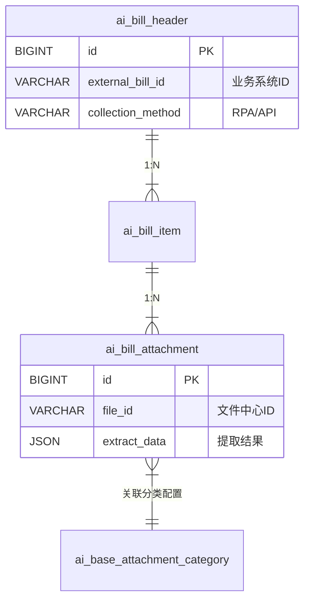
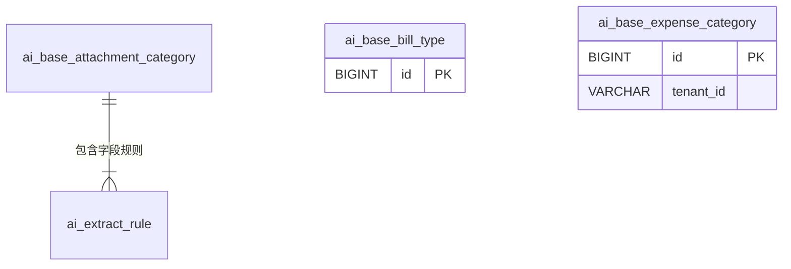
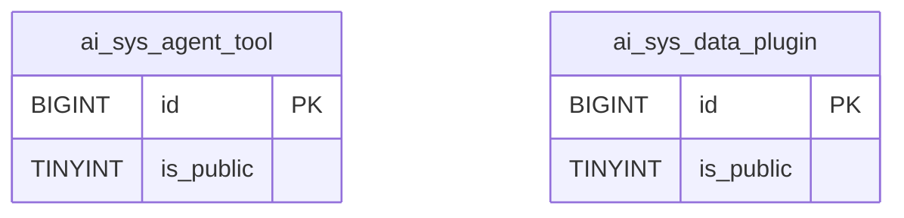
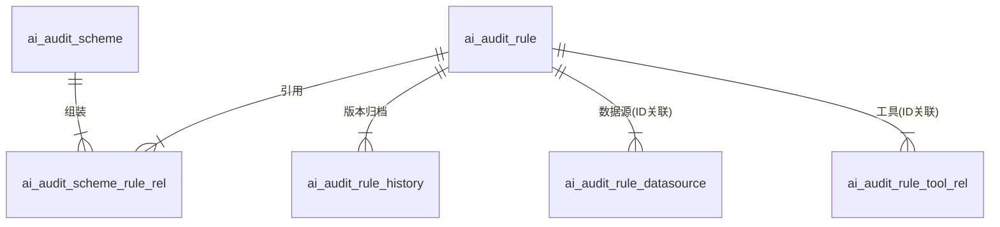
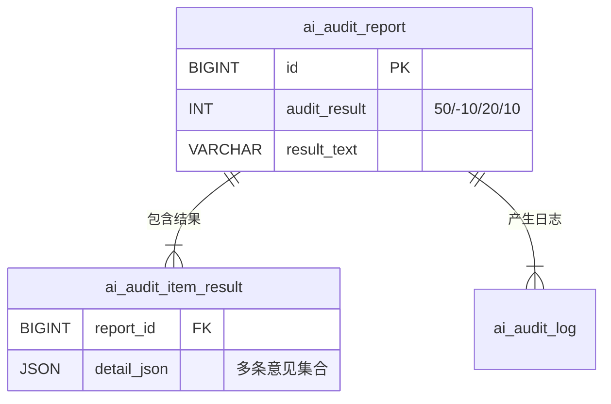
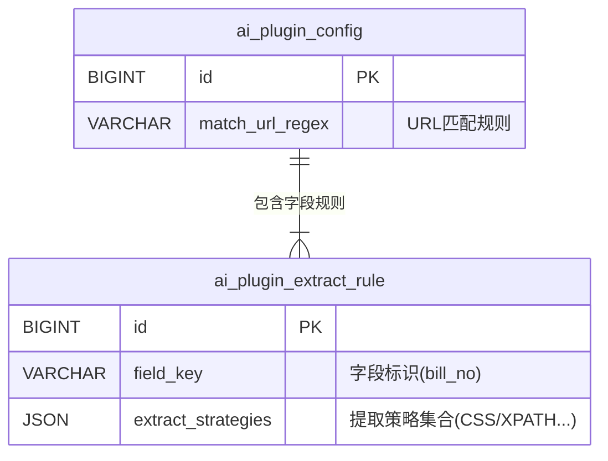

# 智能财务合规平台 (AI-Audit) 数据库设计文档 V2.0 (飞书优化版)

# 1. 业务接入与存储模块

## 1.1 模块 ER 图

## 1.2 表结构定义

### Table: `ai_bill_header` (单据主表)

| 序号 | 字段名 | 类型 | 必填 | 描述 |
| --- | --- | --- | --- | --- |
| 1 | `id` | BIGINT | Y | 主键ID (雪花算法) |
| 2 | `tenant_id` | VARCHAR(32) | Y | 租户ID |
| 3 | `bill_no` | VARCHAR(64) | Y | 外部单据展示号 (如 `BX-20250101`) |
| 4 | `external_bill_id` | VARCHAR(64) | N | 🔹 **[新增]** 业务系统内部ID (用于解决单号重复/绑定唯一性) |
| 5 | `app_id` | VARCHAR(32) | Y | 来源应用标识 (`SAP`/`OA`/`K3`) |
| 6 | `collection_method` | VARCHAR(20) | Y | 🔹 **[新增]** 采集方式: `RPA` (机器人抓取), `API` (接口推送) |
| 7 | `bill_type_id` | BIGINT | Y | 关联 `ai_base_bill_type\.id` |
| 8 | `biz_data` | JSON | N | 泛化业务字段 (申请人, 部门, 项目等) |
| 9 | `total_amount` | DECIMAL(18,2) | N | 冗余总金额 |
| 10 | `submit_time` | DATETIME | Y | 业务提交时间 |
| 11 | `create_time` | DATETIME | Y | 入库时间 |

### Table: `ai_bill_item` (单据明细表)

| 序号 | 字段名 | 类型 | 必填 | 描述 |
| --- | --- | --- | --- | --- |
| 1 | `id` | BIGINT | Y | 主键ID |
| 2 | `header_id` | BIGINT | Y | 关联 `ai_bill_header\.id` |
| 3 | `line_no` | VARCHAR(32) | Y | 外部行号 |
| 4 | `item_code` | VARCHAR(50) | Y | 费用科目代码 (对应 `ai_base_expense_category`) |
| 5 | `biz_data` | JSON | N | 泛化明细字段 |
| 6 | `declared_amount` | DECIMAL(18,2) | Y | 申报金额 |

### Table: `ai_bill_attachment` (附件与提取表)

| 序号 | 字段名 | 类型 | 必填 | 描述 |
| --- | --- | --- | --- | --- |
| 1 | `id` | BIGINT | Y | 主键ID |
| 2 | `item_id` | BIGINT | Y | 关联 `ai_bill_item\.id` |
| 3 | `file_id` | VARCHAR(64) | Y | 🔹 **[新增]** 关联文件中心/OSS系统的唯一文件ID |
| 4 | `file_url` | VARCHAR(512) | Y | 文件下载/预览地址 |
| 5 | `file_type` | VARCHAR(20) | Y | `pdf`, `jpg`, `png` |
| 6 | `category_id` | BIGINT | N | 🔄 **[修改]** 关联 `ai_base_attachment_category\.id` (租户隔离) |
| 7 | `extract_data` | JSON | N | 🔄 **[修改]** 提取数据包 (含OCR结果、视觉分析结果、提取状态) |
| 8 | `extract_status` | TINYINT | Y | `0`:待提取, `1`:成功, `2`:失败 |

---

# 2. 基础数据与提取配置模块

## 2.1 模块 ER 图

## 2.2 表结构定义

### Table: `ai_base_bill_type` (单据类型表)

| 序号 | 字段名 | 类型 | 必填 | 描述 |
| --- | --- | --- | --- | --- |
| 1 | `id` | BIGINT | Y | PK |
| 2 | `tenant_id` | VARCHAR(32) | Y | 租户ID |
| 3 | `system_id` | BIGINT | Y | 🔹 **[新增]** 关联 `ai_source_system` |
| 4 | `type_code` | VARCHAR(50) | Y | 业务代码 (`SAP_TRAVEL`) |
| 5 | `type_name` | VARCHAR(100) | Y | 名称 |
| 6 | `url_match_regex` | VARCHAR(500) | N | 🔄 **[迁移]** 插件激活正则 (`^.*/travel/.*`) |
| 7 | `description` | VARCHAR(255) | N | 描述 |
| 8 | `is_enable` | TINYINT | Y | 是否启用 |

### Table: `ai_base_expense_category` (费用科目表)

_注：已去除 Mapping 表，此表承载租户级科目定义_

| 序号 | 字段名 | 类型 | 必填 | 描述 |
| --- | --- | --- | --- | --- |
| 1 | `id` | BIGINT | Y | 🔹 **[新增]** 主键ID |
| 2 | `tenant_id` | VARCHAR(32) | Y | 🔹 **[新增]** 租户隔离 |
| 3 | `category_code` | VARCHAR(50) | Y | 业务系统中的科目代码 (如 `6001`) |
| 4 | `category_name` | VARCHAR(100) | Y | 科目名称 (如 `住宿费`) |
| 5 | `ai_aliases` | JSON | N | 辅助AI识别的别名 `["房费", "Loding"]` |
| 6 | `create_time` | DATETIME | Y | 🔹 **[新增]** 创建日期 |

### Table: `ai_base_attachment_category` (附件分类表)

| 序号 | 字段名 | 类型 | 必填 | 描述 |
| --- | --- | --- | --- | --- |
| 1 | `id` | BIGINT | Y | 🔹 **[新增]** 主键ID |
| 2 | `tenant_id` | VARCHAR(32) | Y | 🔹 **[新增]** 租户隔离 |
| 3 | `category_name` | VARCHAR(100) | Y | 名称 (如 `增值税发票`) |
| 4 | `model_id` | VARCHAR(50) | N | 🔹 **[新增]** 关联的模型ID (如 `Qwen-VL-Max`) |
| 5 | `extract_method` | VARCHAR(20) | Y | 🔹 **[新增]** `OCR_LLM` (文字识别+推理), `VISION` (纯视觉) |
| 6 | `ocr_provider` | VARCHAR(50) | N | 🔹 **[新增]** OCR供应商: `Paddle`, `Deepseek`, `Azure` (字典项) |
| 7 | `description` | VARCHAR(255) | N | 描述 |
| 8 | `extract_prompt` | TEXT | N | 分类提示词 |
| 9 | `enable_structure` | TINYINT | N | 是否开启文档结构/封面检测 (`1`:开启, `0`:关闭) |

### Table: `ai_extract_rule` (提取规则字段表)

_注：从分类表中拆分出的独立子表，用于定义具体的提取字段_

| 序号 | 字段名 | 类型 | 必填 | 描述 |
| --- | --- | --- | --- | --- |
| 1 | `id` | BIGINT | Y | 主键ID |
| 2 | `attachment_category_id` | BIGINT | Y | 关联 `ai_base_attachment_category\.id` |
| 3 | `field_key` | VARCHAR(50) | Y | 字段英文名 (如 `total_amt`) |
| 4 | `field_desc` | VARCHAR(100) | Y | 字段描述 (传给AI看) |
| 5 | `ai_prompt` | TEXT | N | 🔹 **[新增]** 针对该字段的专用提取提示词 |
| 6 | `extract_scheme` | VARCHAR(20) | Y | 🔹 **[新增]** `AI` (大模型), `REGEX` (正则匹配) |
| 7 | `field_type` | VARCHAR(20) | Y | 🔹 **[新增]** `NUMBER`, `STRING`, `JSON`, `DATE` |
| 8 | `remark` | VARCHAR(200) | N | 备注 |

### Table: `ai_sys_config` (系统全局配置表)

_此表用于存储全局策略配置，采用 Key-Value 结构以支持未来的扩展_

| 序号 | 字段名         | 类型         | 必填 | 描述                        |
| ---- | -------------- | ------------ | ---- | --------------------------- |
| 1    | `id`           | BIGINT       | Y    | 主键                        |
| 2    | `tenant_id`    | VARCHAR(32)  | Y    | 租户隔离                    |
| 3    | `config_key`   | VARCHAR(50)  | Y    | 配置键                      |
| 4    | `config_value` | TEXT         | N    | 配置值-建议存大Json         |
| 5    | `group_code`   | VARCHAR(50)  | Y    | 分组 (如 `ATTACH_STRATEGY`) |
| 6    | `description`  | VARCHAR(200) | N    | 描述                        |

---

# 3. 插件与工具模块

## 3.1 模块 ER 图

## 3.2 表结构定义

### Table: `ai_sys_agent_tool` (工具注册表)

| 序号 | 字段名 | 类型 | 必填 | 描述 |
| --- | --- | --- | --- | --- |
| 1 | `id` | BIGINT | Y | PK |
| 2 | `tenant_id` | VARCHAR(32) | Y | 租户ID |
| 3 | `tool_key` | VARCHAR(64) | Y | 🔹 **[核心]** AI 调用的函数名 |
| 4 | `tool_name` | VARCHAR(100) | Y | 展示名称 |
| 5 | `implementation_type` | VARCHAR(20) | Y | 🔹 **[新增]** `MCP` / `NATIVE` |
| 6 | `mcp_config` | JSON | N | 🔹 **[新增]** MCP 配置 `{ "url": "...", "mode": "HTTP/SSE", "headers": {...} }` |
| 7 | `native_signature` | VARCHAR(255) | N | 🔹 **[新增]** 内置方法签名 `Audit.Plugins.TimePlugin.GetCurrentTime` |
| 8 | `description_ai` | TEXT | Y | Prompt (可覆盖默认描述) |
| 9 | `param_schema` | JSON | N | 参数定义 (MCP从Server拉取，Native从代码反射) |
| 10 | `is_public` | TINYINT | Y | 是否公共工具 |

### Table: `ai_sys_data_plugin` (数据源插件表)

| 序号 | 字段名 | 类型 | 必填 | 描述 |
| --- | --- | --- | --- | --- |
| 1 | `id` | BIGINT | Y | 🔹 **[新增]** 主键ID |
| 2 | `tenant_id` | VARCHAR(32) | Y | 🔹 **[新增]** 租户隔离 |
| 3 | `plugin_code` | VARCHAR(64) | Y | 插件编码 |
| 4 | `description` | VARCHAR(255) | N | 🔹 **[新增]** 插件描述 |
| 5 | `is_enable` | TINYINT | Y | 🔹 **[新增]** `1`启用 `0`禁用 |
| 6 | `is_public` | TINYINT | Y | 🔹 **[新增]** `1`:公共插件, `0`:租户自研 |
| 7 | `api_url` | VARCHAR(512) | Y | 接口地址 |
| 8 | `auth_config` | JSON | N | 鉴权配置 |

---

# 4. 智审策略配置模块

## 4.1 模块 ER 图

## 4.2 表结构定义

### Table: `ai_audit_scheme` (审核方案表)

| 序号 | 字段名 | 类型 | 必填 | 描述 |
| --- | --- | --- | --- | --- |
| 1 | `id` | BIGINT | Y | 主键ID |
| 2 | `tenant_id` | VARCHAR(32) | Y | 租户ID |
| 3 | `scheme_name` | VARCHAR(100) | Y | 方案名称 |
| 4 | `bill_type_id` | BIGINT | Y | 🔄 **[修改]** 关联 `ai_base_bill_type\.id` |
| 5 | `min_confidence` | INT | Y | 🔹 **[新增]** 全局最低置信度 (0-100) |
| 6 | `is_enable` | TINYINT | Y | 🔹 **[新增]** 是否启用 |
| 7 | `remark` | VARCHAR(255) | N | 🔹 **[新增]** 备注 |
| 8 | `create_time` | DATETIME | Y | 🔹 **[新增]** 创建时间 |
| 9 | `create_by` | VARCHAR(64) | Y | 🔹 **[新增]** 创建人 |

### Table: `ai_audit_rule` (规则定义表)

| 序号 | 字段名 | 类型 | 必填 | 描述 |
| --- | --- | --- | --- | --- |
| 1 | `id` | BIGINT | Y | 主键ID |
| 2 | `tenant_id` | VARCHAR(32) | Y | 租户ID |
| 3 | `rule_name` | VARCHAR(100) | Y | 规则名称 |
| 4 | `rule_type` | VARCHAR(20) | Y | `LOGIC` / `AGENT` |
| 5 | `description` | VARCHAR(500) | N | 🔹 **[新增]** 规则业务描述 |
| 6 | `prompt_template` | TEXT | N | 提示词模板 |
| 7 | `version` | VARCHAR(20) | Y | 🔹 **[新增]** 当前版本号 (`V1.0`) |
| 8 | `is_enable` | TINYINT | Y | 🔹 **[新增]** 是否启用 |
| 9 | `create_time` | DATETIME | Y | 🔹 **[新增]** 创建时间 |
| 10 | `create_by` | VARCHAR(64) | Y | 🔹 **[新增]** 创建人 |

### Table: `ai_audit_rule_history` (规则版本历史表)

_注：用于回滚和审计，存储压缩快照_

| 序号 | 字段名 | 类型 | 必填 | 描述 |
| --- | --- | --- | --- | --- |
| 1 | `id` | BIGINT | Y | 主键ID |
| 2 | `rule_id` | BIGINT | Y | 关联 `ai_audit_rule\.id` |
| 3 | `version` | VARCHAR(20) | Y | 版本号 |
| 4 | `name` | VARCHAR(100) | Y | 当时规则名称 |
| 5 | `snapshot_json` | LONGTEXT | Y | 🔹 **[核心]** 压缩大JSON (含数据源配置、工具关联、Prompt的完整备份) |
| 6 | `create_time` | DATETIME | Y | 归档时间 |
| 7 | `create_by` | VARCHAR(64) | Y | 操作人 |

### Table: `ai_audit_scheme_rule_rel` (方案-规则关联表)

| 序号 | 字段名 | 类型 | 必填 | 描述 |
| --- | --- | --- | --- | --- |
| 1 | `id` | BIGINT | Y | 主键ID |
| 2 | `scheme_id` | BIGINT | Y | 关联方案 |
| 3 | `rule_id` | BIGINT | Y | 关联规则 |
| 4 | `min_confidence` | INT | N | 🔹 **[新增]** 该规则在此方案下的最低置信度 |
| 5 | `sort_index` | INT | Y | 🔄 **[修改]** 执行排序索引 (原 priority) |
| 6 | `risk_level` | VARCHAR(20) | Y | `BLOCK` / `WARNING` |
| 7 | `custom_params` | JSON | N | 参数重载 |

### Table: `ai_audit_rule_datasource` (规则数据源配置)

| 序号 | 字段名 | 类型 | 必填 | 描述 |
| --- | --- | --- | --- | --- |
| 1 | `id` | BIGINT | Y | 主键ID |
| 2 | `rule_id` | BIGINT | Y | 关联规则 |
| 3 | `context_key` | VARCHAR(50) | Y | 变量名 |
| 4 | `source_type` | VARCHAR(20) | Y | `HEADER`/`ITEMS`/`PLUGIN` |
| 5 | `ref_id` | BIGINT | N | 🔄 **[修改]** 关联主数据ID (如 `ai_base_expense_category\.id` 或 `ai_sys_data_plugin\.id`) |
| 6 | `filter_exp` | VARCHAR(200) | N | 过滤表达式 (如 `>500`) |
| 7 | `plugin_params` | JSON | N | 插件固定参 |

### Table: `ai_audit_rule_tool_rel` (规则工具关联)

| 序号 | 字段名 | 类型 | 必填 | 描述 |
| --- | --- | --- | --- | --- |
| 1 | `id` | BIGINT | Y | 主键ID |
| 2 | `rule_id` | BIGINT | Y | 关联规则 |
| 3 | `tool_id` | BIGINT | Y | 🔄 **[修改]** 关联 `ai_sys_agent_tool\.id` |

---

# 5. 审核执行与日志模块

## 5.1 模块 ER 图

## 5.2 表结构定义

### Table: `ai_audit_report` (审核报告表)

_注：原 task 表改名，代表最终交付物_

| 序号 | 字段名 | 类型 | 必填 | 描述 |
| --- | --- | --- | --- | --- |
| 1 | `id` | BIGINT | Y | 🔹 **[新增]** 主键ID |
| 2 | `tenant_id` | VARCHAR(32) | Y | 🔹 **[新增]** 租户ID |
| 3 | `bill_header_id` | BIGINT | Y | 关联单据 |
| 4 | `scheme_id` | BIGINT | Y | 🔄 **[修改]** 关联 `ai_audit_scheme\.id` |
| 5 | `audit_result` | INT | Y | 🔄 **[修改]** 结果码: `50`通过, `-10`拒绝, `20`警告, `10`退回 |
| 6 | `result_text` | VARCHAR(100) | Y | 🔹 **[新增]** 结果文本 (如 "通过", "存在合规风险") |
| 7 | `avg_confidence` | DECIMAL(5,2) | N | 🔹 **[新增]** 平均置信度 |
| 8 | `is_human_review` | TINYINT | Y | 🔹 **[新增]** 是否需要人工审核 (`1`/`0`) |
| 9 | `create_time` | DATETIME | Y | 开始时间 |
| 10 | `finish_time` | DATETIME | N | 🔹 **[新增]** 完成时间 |

### Table: `ai_audit_log` (审核过程日志表)

_注：用于全链路追踪每一条单据的处理状态_

| 序号 | 字段名 | 类型 | 必填 | 描述 |
| --- | --- | --- | --- | --- |
| 1 | `id` | BIGINT | Y | 主键ID |
| 2 | `report_id` | BIGINT | Y | 关联报告ID |
| 3 | `bill_header_id` | BIGINT | Y | 关联单据 |
| 4 | `batch_no` | VARCHAR(64) | Y | 🔹 **[新增]** 批次号 (用于一次API请求的追踪) |
| 5 | `current_status` | INT | Y | 🔹 **[新增]** `0`未开始, `10`进行中, `30`完成, `-10`报错 |
| 6 | `status_reason` | VARCHAR(500) | N | 🔹 **[新增]** 状态原因/报错信息 |
| 7 | `input_params` | JSON | N | 🔹 **[新增]** 调用时的入参快照 |
| 8 | `start_time` | DATETIME | Y | 步骤开始时间 |
| 9 | `end_time` | DATETIME | N | 步骤结束时间 |

### Table: `ai_audit_item_result` (审核明细结果)

| 序号 | 字段名 | 类型 | 必填 | 描述 |
| --- | --- | --- | --- | --- |
| 1 | `id` | BIGINT | Y | 主键ID |
| 2 | `report_id` | BIGINT | Y | 🔄 **[修改]** 关联 `ai_audit_report\.id` |
| 3 | `item_id` | BIGINT | N | 关联单据明细 |
| 4 | `rule_id` | BIGINT | Y | 关联规则 |
| 5 | `is_pass` | TINYINT | Y | `1`通过 `0`不通过 |
| 6 | `detail_json` | JSON | Y | 🔄 **[修改]** 审核意见集合 `[{ "pass": false, "reason": "超标", "desc": "规则描述" }]` |
| 7 | `evidence_snapshot` | JSON | N | 证据快照 |

---

# 6. 浏览器插件配置模块

## 6.1 模块 ER 关系图

## 6.2 表结构定义

### Table: `ai_source_system` (业务系统注册表)

| 序号 | 字段名        | 类型         | 必填 | 描述                |
| ---- | ------------- | ------------ | ---- | ------------------- |
| 1    | `id`          | BIGINT       | Y    | PK                  |
| 2    | `tenant_id`   | VARCHAR(32)  | Y    | 租户ID              |
| 3    | `system_name` | VARCHAR(100) | Y    | 系统名称 (`SAP HQ`) |
| 4    | `system_code` | VARCHAR(50)  | Y    | 唯一编码            |
| 5    | `base_url`    | VARCHAR(255) | N    | 系统基准地址        |
| 6    | `auth_config` | JSON         | N    | 接口/RPA鉴权配置    |
| 7    | `is_enable`   | TINYINT      | Y    | 是否启用            |

### Table: `ai_plugin_extract_rule` (插件字段提取规则表)

_提取字段规则挂在 bill_type 下_

| 序号 | 字段名 | 类型 | 必填 | 描述 |
| --- | --- | --- | --- | --- |
| 1 | `id` | BIGINT | Y | PK |
| 2 | `bill_type_id` | BIGINT | Y | 🔄 **[修改]** 关联 `ai_base_bill_type` |
| 3 | `field_key` | VARCHAR(50) | Y | 字段标识 (`bill_no`, `total_amt`) |
| 4 | `field_desc` | VARCHAR(100) | Y | 描述 |
| 5 | `extract_strategies` | JSON | Y | 提取策略集合 (`ID`/`CSS`/`XPATH`/`REGEX`) |
| 6 | `is_required` | TINYINT | Y | 是否必填 |

### Table: `ai_plugin_global_config` (插件全局配置表)

_用于存储不绑定单据的通用设置_

| 序号 | 字段名               | 类型         | 必填 | 描述                  |
| ---- | -------------------- | ------------ | ---- | --------------------- |
| 1    | `id`                 | BIGINT       | Y    | PK                    |
| 2    | `tenant_id`          | VARCHAR(32)  | Y    | 租户ID                |
| 3    | `standalone_api_url` | VARCHAR(255) | N    | 私有化后端地址        |
| 4    | `debug_mode`         | TINYINT      | Y    | 是否开启调试日志      |
| 5    | `ui_preference`      | JSON         | N    | 界面偏好 (如悬浮位置) |

---
