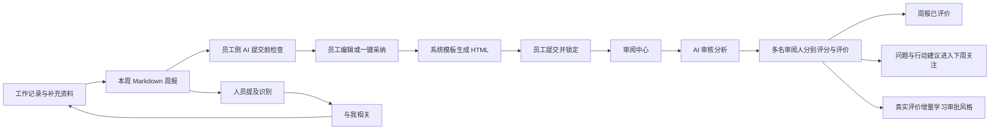

# 汇报助理与审阅助理产品需求文档

> 文档版本：V1.0  
> 编写日期：2026-08-14  
> 对应范围：数字员工中心 / 汇报助理、审阅助理  
> 依据：当前前端 Demo 页面、交互与 Mock 数据  
> 明确排除：数字员工对话/聊天页面本身

## 1. 文档目的

本文档梳理汇报助理与审阅助理下除“对话”之外的全部菜单能力，统一产品边界、业务流程、角色权限、状态规则和验收口径，为后续产品评审、视觉深化、接口设计和正式开发提供依据。

虽然对话页面不在本次范围内，但系统允许接收由上游 AI 对话抽取出的“工作记录”“人员提及”等结构化数据。本文只描述这些结果如何进入本模块，不描述聊天交互。

## 2. 产品背景与核心问题

传统周报工具主要解决填写和存档，存在以下问题：

1. 员工需要重复整理零散资料，填写成本高。
2. 周报内容格式不统一，成果、风险、计划的完整性难以保证。
3. 主管需要逐份打开、人工寻找问题，审阅效率低。
4. 主管提问、行动建议和员工回复散落在评论中，难以跨周跟进。
5. 周报中出现的跨部门协助请求不能稳定触达被提及人。
6. 不同岗位、不同主管的评价标准不同，通用 AI 建议不够贴合实际职责。
7. 周报、原始附件、项目/客户/产品实体之间缺少可追溯关联。

产品以“Markdown 内容源 + HTML 阅读版本 + AI 提交前检查 + AI 审阅分析 + 人工评价”为核心，形成从日常记录到跨周管理闭环。

## 3. 产品目标

### 3.1 业务目标

- 降低员工整理周报的时间成本。
- 提高周报在成果、风险、计划和证据方面的完整度。
- 帮助主管优先发现需要关注、追问和协调的问题。
- 保留原文、附件、实体和评价依据，提升信息可信度。
- 将主管提问和行动建议延续到下一周，但不强制将所有事项任务化。
- 持续学习主管的真实评价习惯，形成个人审批风格。

### 3.2 非目标

- 不建设完整项目管理或任务管理系统。
- 不自动把每一句承诺强制拆成正式任务。
- 不由 AI 代替主管作出最终评价。
- 周报没有“同意/拒绝”流程，仅有提交、评价和已评价状态。
- 本期不描述数字员工聊天界面。

## 4. 用户角色

| 角色 | 核心诉求 | 主要权限 |
| --- | --- | --- |
| 员工 | 记录工作、完善本周周报、查看历史周报、处理他人提及 | 编辑草稿、补充资料、采纳员工侧 AI 建议、生成 HTML、提交、评论、回复、点赞、分享授权范围内内容 |
| 审阅人/主管 | 快速浏览团队周报、查看 AI 分析、评分并评价、跟进问题 | 查看所属团队报告与证据、查看实体、独立评分和评价、确认批复、评论、回复、形成下周关注 |
| 多级审阅人 | 对同一周报分别给出评价 | 查看其他审阅人的状态和已公开结果，提交自己的独立评分与评价 |
| 管理员 | 配置岗位审核策略、提交前检查规则和 HTML 模板 | 维护岗位审核策略组、员工侧检查提示词、系统 HTML 模板及适用部门 |

## 5. 信息架构与菜单范围

### 5.1 汇报助理

| 菜单 | 路由 | 定位 |
| --- | --- | --- |
| 本周周报 | `/app/mate/employee/report-copilot/current-report` | 编辑和完善本周 Markdown 周报，生成 HTML 并提交 |
| 历史周报 | `/app/mate/employee/report-copilot/report` | 按月、周查询已提交或已评价的历史周报 |
| 工作记录 | `/app/mate/employee/report-copilot/work-records` | 管理日常逐条工作事项及其附件和实体关联 |
| 与我相关 | `/app/mate/employee/report-copilot/mentions` | 处理其他员工周报中对当前用户的协助请求、提问和知会 |

### 5.2 审阅助理

| 菜单 | 路由 | 定位 |
| --- | --- | --- |
| 审阅中心 | `/app/mate/employee/review-copilot/review` | 按周、部门查看员工周报状态并进入评价 |
| 下周关注 | `/app/mate/employee/review-copilot/follow-ups` | 汇总主管提问和行动建议，持续检查回应与进展 |
| 审批风格 | `/app/mate/employee/review-copilot/approval-style` | 查看和维护 AI 从历史评价中提炼的个人判断与表达偏好 |
| 审核设置 | `/app/mate/employee/review-copilot/settings` | 按岗位配置审核策略，并配置员工提交前检查和系统 HTML 模板 |

### 5.3 共用页面

| 页面 | 入口 | 用途 |
| --- | --- | --- |
| Markdown 周报工作台 | 本周周报、历史周报 | 员工侧编辑/阅读、资料补充、互动、提交 |
| 独立 HTML 周报页 | HTML 卡片“查看”、审阅中心员工卡片 | 富文本阅读、证据预览、实体查看、互动；审阅模式下增加 AI 审核和多人评价 |

## 6. 核心业务流程

## 7. 核心业务对象与状态

### 7.1 周报状态

| 状态 | 含义 | 员工可编辑 | 可生成 HTML | 可提交 | 可评价 |
| --- | --- | --- | --- | --- | --- |
| 草稿 `draft` | 当前周未提交周报 | 是 | 是 | 是 | 否 |
| 已提交 `submitted` | 员工已确认并提交 | 否 | 否 | 否 | 是 |
| 已评价 `reviewed` | 所需审阅流程完成 | 否 | 否 | 否 | 查看结果 |

规则：

- 提交后 Markdown 和对应 HTML 版本同时锁定。
- 已提交、已评价状态不提供重新生成 HTML。
- 产品文案统一使用“评价/已评价”或“审核/已审核”；不出现“通过/拒绝”。
- 多人审核时，每名审阅人有独立状态；周报整体状态由审批策略决定，默认所有必需审阅人完成后变为已评价。

### 7.2 工作记录

工作记录是周报形成前的轻量事实条目，不是待办。主要字段包括日期、星期、时间、工作事项、来源、附件和关联实体。

来源包括：

- 员工手动录入。
- 上游 AI 从对话或资料中抽取后写入。
- 从“与我相关”的协助请求转入。

### 7.3 与我相关状态

| 状态 | 含义 |
| --- | --- |
| 待处理 `pending` | 尚未确认或回应 |
| 已回复 `replied` | 已向来源周报同步回复 |
| 已转记录 `recorded` | 已转为当前用户的工作记录 |
| 已知晓 `known` | 无需动作，仅确认知晓 |
| 已忽略 `ignored` | 判断为误识别或无需处理 |

### 7.4 评论类型

- 普通评论：公开讨论，不自动进入下周关注。
- 主管提问：需要员工回应，进入下周关注。
- 行动建议：建议在后续周报中体现进展，进入下周关注。

## 8. 功能需求

## 8.1 汇报助理—本周周报

### 8.1.1 页面概览

页面不显示历史筛选栏，最大化当前周报编辑空间。若存在待处理的“与我相关”，顶部显示提醒条并可跳转处理。

### 8.1.2 Markdown 内容管理

- 默认展示渲染后的 Markdown 文档。
- 草稿状态显示“编辑”，点击后进入 Markdown 文本编辑器。
- 支持保存、取消编辑；保存 Markdown 不自动更新 HTML。
- 编辑区明确提示“只有重新生成 HTML 才会更新分享页”。
- 已提交和已评价周报只读。

### 8.1.3 员工侧 AI 完善建议

- 仅草稿状态显示。
- 至少输出：完整度百分比、等级评价、缺失项、优化建议、可采纳内容。
- 可一键采纳建议，将建议内容合并进 Markdown 后重新渲染。
- AI 不得给出主管评分、同意、拒绝或评价结论。
- 示例：提醒下周计划缺少负责人、完成时间、验收标准。

### 8.1.4 关联资料

- 右侧小边栏展示当前周报关联资料数量和清单。
- 草稿状态提供“补充资料”上传按钮，支持多文件。
- 文件类型至少覆盖音频、视频、图片和文档。
- 正式产品需存储文件、元数据、上传人、上传时间和周报关联关系。
- 当前页面不展示关联实体；实体集中在独立 HTML 阅读/审核页使用。

### 8.1.5 HTML 版本生成

- Markdown 文档上方显示一条深色渐变的 HTML 版本卡片。
- 未生成时显示“生成”；已生成时显示“重新生成”和“查看”。
- 已提交、已评价时仅允许查看，并显示锁定状态。
- 员工只看到系统模板名称、用途和能力说明，不得查看或编辑生成提示词。
- HTML 生成规则由管理员在“审核设置—周报模板配置”中统一维护。
- 生成结果为独立页面，支持新页签打开和分享。

### 8.1.6 提交

- 草稿状态显示“提交”按钮。
- 提交前需确认当前 Markdown 已保存；正式产品建议检查 HTML 是否为最新版本。
- 提交成功后锁定 Markdown 与 HTML，不再允许编辑或重新生成。

### 8.1.7 社交互动

- 支持点赞、显示点赞数量和点赞人姓名。
- 支持普通评论、主管提问、行动建议。
- 支持查看评论及嵌套回复。
- 支持配置分享对象和权限，复制 HTML 分享链接、新页签预览。

### 8.1.8 验收标准

- 草稿可编辑、保存、补充资料、采纳建议、生成 HTML 和提交。
- 已提交/已评价不能编辑或生成 HTML。
- 员工无法从任何弹窗查看系统 HTML 生成提示词。
- 一键采纳后 Markdown 内容发生可见变化。
- 提交后状态与操作区同步切换为锁定。

## 8.2 汇报助理—历史周报

### 8.2.1 归档导航

- 左侧按月份分组，月份可展开/折叠。
- 月内周次倒序排列，展示周次、自然日期范围和状态。
- 归档面板支持整体折叠；周报标题左侧和面板标题右侧均提供折叠入口。
- 折叠后右侧周报区域自动占满可用宽度。

### 8.2.2 阅读与互动

- 仅显示非草稿历史周报。
- 页面与本周周报使用相同内容组件，但不显示编辑、生成、上传和提交功能。
- 保留点赞、评论、分享以及已有 HTML 的查看能力。

### 8.2.3 验收标准

- 可按月和周切换历史周报。
- 收起左栏后正文自适应全宽。
- 历史周报无任何编辑类入口。

## 8.3 汇报助理—工作记录

### 8.3.1 筛选与排序

- 左侧提供“全部、本周、本月、今年”四类日期筛选。
- 右侧工作记录按日期、时间倒序排列。
- 日期放在每条记录最前面，并展示星期。
- 列表采用紧凑密度，一屏应能浏览约 10 条以上记录。

### 8.3.2 记录管理

- 支持手动新增工作记录。
- 点击工作事项正文直接进入文本编辑，支持保存和取消。
- 支持删除，删除前二次确认。
- 不展示对话原文；工作事项以整理后的事实描述为主。
- 前置图标表达“记录/来源”，不得使用完成勾选图标，避免误解为待办。

### 8.3.3 附件与实体

- 单条工作记录支持补充附件。
- 展开后显示关联资料和 AI 自动识别的项目、客户、产品实体。
- 正式产品中，附件和实体关联应成为生成周报时的可选证据来源。

### 8.3.4 验收标准

- 四种日期过滤结果和计数正确。
- 新增、编辑、删除、补充附件有明确反馈。
- 排序始终为最新记录在前。

## 8.4 汇报助理—与我相关

### 8.4.1 识别范围

AI 从他人周报中识别与当前用户有关的内容，并分类为：

- 需要协助：例如“需要李四协助开发前端页面”。
- 需要回复：对当前用户提出明确问题。
- 需要知晓：相关事项可能影响当前用户，但暂无明确动作。

### 8.4.2 列表与详情

- 默认筛选“待处理”，支持全部、待处理、已回复、已转记录、已知晓、已忽略。
- 列表展示来源人、头像、部门、周次、时间、类型、摘要和状态。
- 详情展示 AI 总结、周报原文引用、来源周报标题与章节、关联实体。
- 提供“查看原周报”入口，打开来源 HTML 页面。

### 8.4.3 处理动作

- 回复：回复同步到来源周报评论，并标记已回复。
- 转为工作记录：将 AI 摘要转入当前用户工作记录，保留来源引用。
- 标记知晓：无需进一步处理。
- 忽略：用于误识别或无关内容。

### 8.4.4 约束

- AI 识别结果是协同提醒，不自动创建正式任务。
- 必须保存原文引用和来源定位，防止 AI 摘要失真。
- 正式产品需支持被提及人对错误识别反馈，反哺识别模型。

## 8.5 审阅助理—审阅中心

### 8.5.1 周次导航

- 左侧按月份文件夹展示周次，月份和周次均倒序。
- 月份可展开/折叠，默认展开最近月份。
- 选择周次后刷新右侧部门及员工报告。

### 8.5.2 部门分组

- 员工按部门组展示，例如产研组、交付与质量组、销售与售前组。
- 部门默认全部展开，可单独折叠。
- 每组展示人数及状态汇总。

### 8.5.3 员工卡片

- 一行至少 4 张紧凑卡片。
- 展示真人/数字员工头像、人名、部门、周报主题、摘要、状态、评分和操作。
- 评分放在卡片右上角，并使用 5 颗真实星形表示；支持全黄、半黄、空心三种状态。
- 状态视觉：绿色表示已评价，低饱和橙色表示待评价，灰色表示未提交。
- 状态不仅用细线表达，头像区域或卡片顶部需有足够宽度的状态色块，并同时显示文字与图标。
- 未提交卡片提供提醒；已提交卡片进入评价；已评价卡片查看结果。

### 8.5.4 快速洞察

- 展示本周提交数、已评价数等统计。
- 展示 AI 团队摘要，帮助主管快速确定审阅顺序。
- 展示本周审批风格学习结果，可跳转审批风格页查看变化。

## 8.6 独立 HTML 周报页

### 8.6.1 页面框架

- 系统顶栏固定在页面顶部。
- 系统右侧边栏固定在浏览器最右侧，固定宽度，建议 410px。
- 顶栏和侧边栏相互紧贴；只有中间左侧的员工 HTML 文档区域保留间距。
- HTML 文档作为独立内容载体，后续可使用 iframe 渲染不同员工生成的页面。
- HTML 内部自带章节导航，支持点击滚动定位。

### 8.6.2 HTML 内容能力

- 支持不同模板、配色、卡片、图表、时间线、进度等丰富呈现。
- 内容必须来自 Markdown，不得虚构原文不存在的数据。
- 支持分享、复制链接和打印。

### 8.6.3 关联材料

- 音频可在侧边栏直接展开播放，并显示 AI 摘要。
- 视频通过浅色弹窗播放。
- 图片和文档通过浅色预览弹窗查看。
- 每项资料展示名称、类型、大小/时长、日期和摘要。

### 8.6.4 关联实体

- AI 根据周报内容和系统数据自动关联项目、客户、产品。
- 点击实体打开大尺寸浅色弹窗。
- 弹窗展示基本信息、负责人、关联信息、AI 近期总结、风险等级与评估。
- 风险判断需注明依据来自最近若干周周报和系统实体数据。

### 8.6.5 员工视图

- 侧边栏显示员工侧 AI 完善建议、完整度和等级。
- 显示点赞、评论、资料和实体。
- 不显示主管专属 AI 审核分析、审批风格命中、多人审核录入区。

### 8.6.6 审阅视图

- 顶栏增加员工切换下拉面板；每项显示头像、人名、部门和已审核/待审核状态，避免重复审核。
- 侧边栏按以下顺序组织：角色说明、审批风格命中、AI 总结分析、AI 深度分析、多人审核进度、当前审阅人评分与批复、公开互动、关联材料、关联实体。
- AI 总结分析至少包含建议评分、整体评价、需要关注、风险、需要追问、建议回复。
- AI 深度分析支持展开/折叠，并提供跨周比较与证据依据。
- 正式评价区与公开评论区必须分开。

### 8.6.7 多人审核

- 展示所需审阅人列表和整体进度，例如“2/3 已审核”。
- 每名审阅人显示头像、姓名、角色、状态、评分、评价和时间。
- 未审核显示明确状态，不显示虚构分数。
- 当前审阅人可调整 0.5 步长的 5 分制评分，编辑 AI 预填评价，再“确认批复”。
- 确认后当前评价锁定，显示已审核。
- AI 建议仅作为初稿，最终评分和评价必须由审阅人主动确认。

## 8.7 审阅助理—下周关注

- 自动汇总周报评论中的“主管提问”和“行动建议”，普通评论不进入。
- 展示待持续关注、等待员工回应、跨部门协同等统计。
- 每项展示类型、来源周报、章节、内容、负责人和最新回应。
- 支持查看原文、提醒相关人员。
- 支持将跨周长期事项转为目标；默认不强制任务化。
- 下一周生成或审阅周报时，应自动检查这些事项是否得到回应。

## 8.8 审阅助理—审批风格

### 8.8.1 个人审批 Skill

- AI 基于真实评分调整、最终评价和回复，按周增量提炼个人审批风格。
- 以 Markdown Skill 形式展示，支持主管查看、编辑和保存。
- 内容维度至少包括：审批原则、关注重点、追问逻辑、不同事项的回复风格、评分偏好。
- 展示版本、更新时间和启用状态。

### 8.8.2 学习变化

- 每周展示新增、覆盖、合并、强化等变化。
- 支持查看变化详情、Markdown Diff 和证据来源。
- 展示 AI 建议采用率等解释性指标。
- 岗位审核策略优先级永远高于个人风格。

### 8.8.3 权限与安全

- 仅本人和管理员可见。
- 不使用其他主管的私有评价数据训练当前用户风格。
- 正式产品需保留版本回滚、关闭自动学习、删除单条学习证据等能力。

## 8.9 审阅助理—审核设置

### 8.9.1 岗位审核策略配置

- 支持新增、删除、启用和停用岗位审核策略组，至少保留一个策略组。
- 一个策略组可绑定一个或多个岗位，例如产品经理、研发工程师、测试工程师、销售经理、售前顾问、交付经理。
- 可配置策略组名称、适用岗位和 AI 审核分析提示词。
- 推荐输出结构固定为：建议评分、整体评价、需要关注、风险、需要追问、建议回复。
- 支持配置员工提交前检查提示词及启停状态。
- 员工侧输出固定为：完整度、等级、缺失项、优化建议、可采纳内容。
- 同一岗位只能命中一个同优先级启用策略；员工兼任多个岗位时，先应用主岗位策略，再按配置顺序叠加副岗位关注项。
- 部门继续用于审阅范围、数据权限和员工分组，不再作为审核策略的匹配依据。

### 8.9.2 周报模板配置

- 支持新增系统 HTML 模板、启用/停用和选择模板。
- 可配置模板名称、适用部门、员工侧说明、视觉主题。
- 可开关页内导航、成果卡片和数据图表。
- 可配置管理员专属 HTML 生成提示词。
- 部门专属模板优先于通用模板；同一部门仅允许一个有效模板。
- 员工只能看到模板名称和用途，不能查看或编辑生成提示词。

## 9. 权限矩阵

| 功能 | 员工本人 | 普通同事 | 审阅人 | 管理员 |
| --- | --- | --- | --- | --- |
| 编辑本人草稿 | 是 | 否 | 否 | 按授权 |
| 补充资料 | 草稿可用 | 否 | 默认否 | 按授权 |
| 生成 HTML | 草稿可用 | 否 | 否 | 可配置模板 |
| 提交周报 | 是 | 否 | 否 | 否 |
| 查看分享周报 | 按授权 | 按授权 | 所属范围 | 是 |
| 评论/点赞 | 按授权 | 按授权 | 是 | 是 |
| 查看员工侧 AI 建议 | 是 | 否 | 可审计 | 可配置 |
| 查看主管 AI 审核分析 | 否 | 否 | 是 | 是 |
| 评分与评价 | 否 | 否 | 被指定时可用 | 按授权 |
| 查看个人审批风格 | 本人是主管时 | 否 | 仅本人 | 是 |
| 配置审核规则/模板 | 否 | 否 | 默认只读或无权 | 是 |

## 10. AI 能力与约束

### 10.1 员工提交前检查

输入：Markdown、当前周工作记录、已授权资料、上周计划。  
输出：完整度、等级、缺失项、优化建议、可采纳文本。  
禁止：评分、同意/拒绝、主管口吻的最终评价。

### 10.2 审阅分析

输入：员工周报、上周计划与本周承接、资料、实体、员工岗位策略、主管个人风格。
输出：建议评分、整体评价、关注点、风险、追问、建议回复及证据引用。  
约束：AI 评分只能作为建议，必须由审阅人确认。

### 10.3 实体识别

实体匹配结果需保存置信度、命中原文和系统实体 ID。低置信度结果应允许用户纠正，不得仅凭名称相似自动形成高风险判断。

### 10.4 审批风格学习

只使用已确认的最终评分、评价和回复；不使用 AI 初稿直接训练。每次更新保留变化记录、证据和版本，可审计、可回滚。

## 11. 通知与提醒

- 周报被他人提及时通知当前用户，并在本周周报顶部显示未处理数量。
- 提交截止前提醒未提交员工。
- 新的主管提问、行动建议和回复通知相关人员。
- 多人审核中仅提醒未审核人员，已审核人员不重复提醒。
- 下周周报生成或审阅时提示尚未回应的关注项。

## 12. 非功能需求

- 正文及操作区字体不得小于 12px；关键正文建议 14px 以上。
- 关键状态必须同时使用文字、图标和颜色，不能只依赖颜色。
- 页面支持常见桌面分辨率；独立 HTML 页右侧栏固定宽度，正文自适应。
- 文件预览需鉴权，分享链接必须校验访问范围和有效期。
- AI 输出必须可追溯到原文、附件或系统实体，不得伪造事实。
- 关键动作保存审计日志：编辑、提交、生成 HTML、评价、规则变更、模板变更、风格学习。

## 13. Demo 现状与产品化差距

| 领域 | 当前 Demo | 产品化要求 |
| --- | --- | --- |
| 数据存储 | 前端 Mock、部分 localStorage | 后端持久化、版本和并发控制 |
| 文件上传 | 本地模拟列表 | 对象存储、鉴权、病毒扫描、预览转换 |
| HTML 生成 | 前端模拟版本 | 异步生成任务、模板版本、失败重试 |
| AI 分析 | 固定演示内容 | 模型调用、提示词编排、证据引用、成本控制 |
| 审核 | 前端状态模拟 | 审阅人配置、并发提交、通知、审计 |
| 审核策略匹配 | Demo 当前按部门选择规则 | 改为按员工主岗位/副岗位匹配策略，部门仅用于权限与分组 |
| 分享 | 演示链接 | 权限、有效期、水印、撤销 |
| 审批风格 | 固定变化样例 | 真实周度训练、版本、回滚、隐私控制 |

## 14. 建议交付优先级

### P0：形成可用闭环

- 工作记录、本周 Markdown、资料上传、AI 提交前检查。
- 系统模板生成 HTML、提交锁定。
- 审阅中心、审阅页 AI 分析、单人/多人评分评价。
- 历史周报与基础评论回复。

### P1：增强管理价值

- 与我相关、下周关注、实体关联与风险分析。
- 岗位审核策略、周报模板配置。
- 审批风格学习与版本审计。

### P2：规模化与治理

- 复杂分享权限、模板市场、规则灰度发布。
- AI 质量评估、误识别反馈、成本与时延监控。
- 对接正式目标管理、项目管理和组织权限体系。

## 15. 总体验收场景

1. 员工新增工作记录并补充附件，进入本周周报查看渲染后的 Markdown。
2. AI 提示下周计划缺项，员工一键采纳并保存。
3. 员工使用内置模板生成 HTML，无法查看提示词，预览后提交。
4. 主管在审阅中心按部门和状态找到该员工，打开 HTML 审阅页。
5. 主管查看附件、实体和 AI 审核分析，修改 AI 预填评价并确认评分。
6. 多名审阅人分别完成评价，页面正确显示每人结果和总体进度。
7. 主管提问进入下周关注；涉及其他员工的协助请求进入“与我相关”。
8. 被提及员工查看原文、回复或转工作记录，回复同步回来源周报。
9. 周度任务基于已确认评价更新主管审批风格，并展示可追溯变化。
