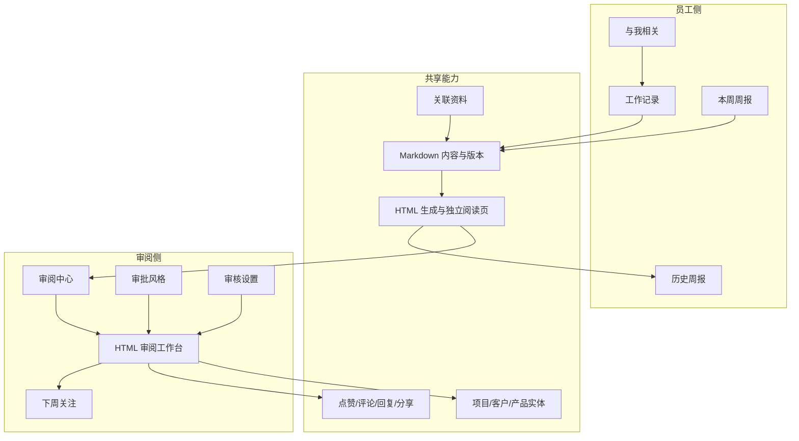
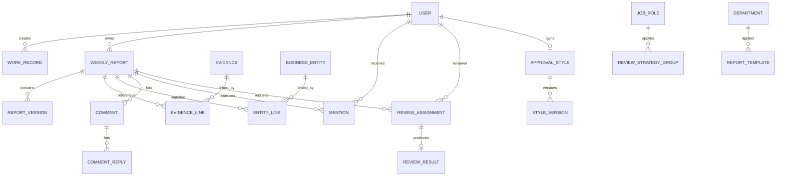
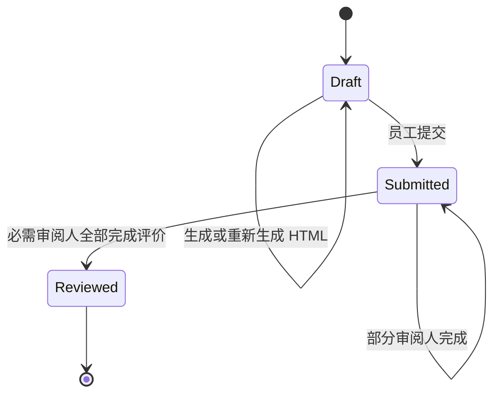
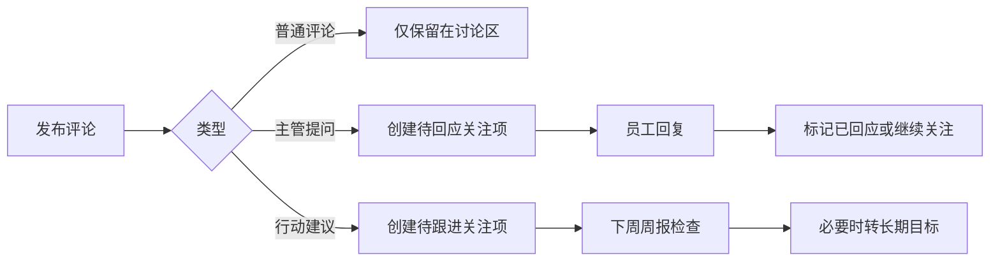
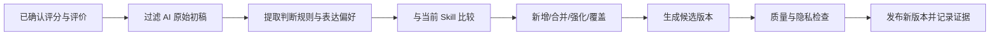

# 汇报助理与审阅助理功能与交互设计文档

> 文档版本：V1.0  
> 编写日期：2026-08-14  
> 对应产品文档：《汇报与审阅助手产品需求文档》  
> 设计基线：当前 Vue 3 前端 Demo  
> 范围说明：排除数字员工对话/聊天页面

## 1. 设计原则

1. **内容源与展示层分离**：Markdown 是可编辑事实源，HTML 是系统模板生成的阅读版本。
2. **员工与审阅人权限分离**：员工侧 AI 负责查缺补漏，审阅侧 AI 负责分析与建议，二者不混用。
3. **AI 建议与人工结论分离**：AI 可生成评分建议和评价初稿，最终结果必须由审阅人确认。
4. **正式评价与公开互动分离**：评分/批复是结构化管理数据，评论/点赞是协作互动。
5. **证据优先**：AI 摘要、风险和实体判断都应可回到原文、附件或系统实体。
6. **轻量跟进**：主管提问和行动建议可跨周延续，但不默认创建正式任务。
7. **状态清楚**：颜色、图标、文字三重表达；全局最小字号 12px。

## 2. 总体架构



## 3. 页面与代码映射

| 页面 | Vue 文件 | 主要依赖 |
| --- | --- | --- |
| 本周周报 | `current-report.vue` | `report-document.vue`、`demo-state.ts` |
| 历史周报 | `report.vue` | `report-document.vue`、`report.css` |
| 工作记录 | `work-records.vue` | `demo-state.ts`、`work-records.css` |
| 与我相关 | `mentions.vue` | `demo-state.ts`、`mentions.css` |
| 审阅中心 | `review.vue` | `review.css`、`review-compact.css` |
| 下周关注 | `follow-ups.vue` | `demo-state.ts` |
| 审批风格 | `approval-style.vue` | `demo-state.ts` |
| 审核设置 | `review-settings.vue` | 3 份 settings CSS |
| 独立 HTML/审核页 | `standalone-report.vue` | standalone 系列 CSS、`demo-state.ts` |
| 菜单配置 | `src/api/mock-data-mate.ts` | `MateEmployeeMenu` |
| 路由配置 | `src/router/routes/core.ts` | Vue Router |

## 4. 领域模型



## 5. 建议数据结构

### 5.1 WeeklyReport

```ts
interface WeeklyReport {
  id: string;
  employeeId: string;
  departmentId: string;
  primaryJobRoleId: string;
  secondaryJobRoleIds?: string[];
  year: number;
  isoWeek: number;
  dateFrom: string;
  dateTo: string;
  title: string;
  markdown: string;
  status: 'draft' | 'submitted' | 'reviewed';
  currentHtmlVersionId?: string;
  submittedAt?: string;
  reviewedAt?: string;
  version: number;
}
```

### 5.2 ReportVersion

```ts
interface ReportVersion {
  id: string;
  reportId: string;
  sourceMarkdownVersion: number;
  templateId: string;
  templateVersion: number;
  htmlStorageKey: string;
  status: 'queued' | 'generating' | 'succeeded' | 'failed';
  generatedAt?: string;
  errorMessage?: string;
}
```

### 5.3 ReviewAssignment 与 ReviewResult

```ts
interface ReviewAssignment {
  id: string;
  reportId: string;
  reviewerId: string;
  reviewerRole: string;
  required: boolean;
  status: 'pending' | 'reviewed';
}

interface ReviewResult {
  assignmentId: string;
  score: number; // 0~5，步长 0.5
  comment: string;
  aiSuggestionSnapshot?: string;
  confirmedAt: string;
}
```

### 5.4 Mention

```ts
interface Mention {
  id: string;
  sourceReportId: string;
  sourceSection: string;
  sourceExcerpt: string;
  authorId: string;
  targetUserId: string;
  type: 'assist' | 'reply' | 'fyi';
  summary: string;
  status: 'pending' | 'replied' | 'recorded' | 'known' | 'ignored';
  confidence: number;
  responseCommentId?: string;
  workRecordId?: string;
}
```

## 6. 周报状态与版本设计



设计规则：

- Markdown 每次保存生成内容版本号。
- HTML 版本绑定生成时的 Markdown 版本与模板版本。
- 若 Markdown 保存后 HTML 未重新生成，显示“HTML 待重新生成”。
- 提交前后端事务应同时校验：报告仍为草稿、当前用户是报告所有者、Markdown 版本未冲突。
- 提交后不允许修改正文或覆盖 HTML。确需更正时，应由管理员开启“撤回/新修订版”，而非直接改旧数据。

## 7. 汇报助理页面设计

## 7.1 本周周报

### 7.1.1 页面布局

```text
┌─────────────────────────────────────────────────────────────┐
│ 与我相关提醒（有待处理项时显示）                              │
├─────────────────────────────────────────────────────────────┤
│ 周报标题 / 周次 / 状态             点赞 评论 分享 编辑 提交   │
├─────────────────────────────────────────────────────────────┤
│ HTML 版本深色细卡片                     生成/重新生成  查看    │
├─────────────────────────────────────────┬───────────────────┤
│                                         │ AI 建议（仅草稿）  │
│ Markdown 渲染正文 / 编辑器              ├───────────────────┤
│                                         │ 关联资料 + 上传    │
├─────────────────────────────────────────┴───────────────────┤
│ 评论与反馈：评论 / 主管提问 / 行动建议                        │
└─────────────────────────────────────────────────────────────┘
```

### 7.1.2 交互状态

| 操作 | 前置条件 | 结果 |
| --- | --- | --- |
| 编辑 | 草稿 | 切换 Markdown 编辑器，隐藏提交前的正文操作 |
| 保存 | 编辑中且非空 | 保存 Markdown；若已有 HTML，标记待重新生成 |
| 一键采纳 | 草稿且存在建议 | 将建议内容合并到 Markdown，并标记有修改 |
| 补充资料 | 草稿 | 多选上传，成功后追加资料列表 |
| 生成 HTML | 草稿 | 打开只读模板确认弹窗，创建生成任务 |
| 查看 HTML | 已有成功版本 | 新页签打开独立 HTML 页面 |
| 提交 | 草稿 | 二次确认后锁定内容，状态变为已提交 |

### 7.1.3 HTML 生成弹窗

弹窗仅显示：

- 当前系统模板名称。
- 员工可理解的模板用途说明。
- 生成能力：页内导航、内容卡片、数据图表、响应式页面。
- 当前内容源为 Markdown。
- “生成 HTML”主按钮。

不显示：模板提示词、系统消息、模型参数、管理员规则。

## 7.2 历史周报

桌面端采用 `归档树 + 阅读区` 两栏布局。归档栏建议宽 280~320px；折叠后阅读区填满。

月份节点：文件夹图标、月份、份数、展开箭头。  
周次节点：时间轴点、周次/W 编号、日期范围、状态标签。  
排序：月份倒序，月内周次倒序。

历史页面调用 `ReportDocument readonly`，从组件层阻断编辑类交互，而不是仅通过 CSS 隐藏。

## 7.3 工作记录

### 7.3.1 布局与密度

```text
┌──────────────┬──────────────────────────────────────────────┐
│ 全部  36     │ 2026-08-14 周五  18:20  工作事项…  来源  >   │
│ 本周  12     │ 2026-08-14 周五  16:40  工作事项…  附件  >   │
│ 本月  31     │ 2026-08-13 周四  19:10  工作事项…  实体  >   │
│ 今年  126    │ …                                            │
└──────────────┴──────────────────────────────────────────────┘
```

- 单行建议高度 48~56px。
- 日期与星期置于最前，时间作为次级信息。
- 事项正文占主要宽度，来源、附件数和展开按钮靠右。
- 展开区显示附件、实体、编辑/删除操作。

### 7.3.2 内联编辑

点击事项正文进入单行/自适应文本框；Enter 或保存按钮提交，Esc 或取消恢复。保存时校验非空，后端使用版本号避免覆盖其他端修改。

### 7.3.3 删除

点击删除后显示二次确认。正式产品建议软删除并记录操作者，已进入已提交周报证据链的记录不得物理删除，只能解除后续关联。

## 7.4 与我相关

采用 `筛选栏 + 来源列表 + 详情区`。移动端可切换为列表到详情的页面跳转。

详情区信息顺序：

1. 类型、状态、来源人和时间。
2. AI 提炼给当前用户的摘要。
3. 原文引用及来源章节。
4. 项目/客户/产品关联。
5. 处理动作与回复编辑器。

“转为工作记录”应携带 `sourceMentionId` 和 `sourceReportId`，保证回溯。回复成功后创建来源周报公开评论，并更新 mention 状态。

## 8. 审阅助理页面设计

## 8.1 审阅中心

### 8.1.1 页面布局

```text
┌────────────┬─────────────────────────────────────────────────┐
│ 月份/周次   │ 本周统计 / AI 团队摘要 / 审批风格学习提示       │
│ 倒序树      ├─────────────────────────────────────────────────┤
│             │ 产研组  6人  ∧                                 │
│             │ [员工卡][员工卡][员工卡][员工卡]                │
│             │ 交付与质量组  4人  ∧                           │
│             │ [员工卡][员工卡][员工卡][员工卡]                │
└────────────┴─────────────────────────────────────────────────┘
```

### 8.1.2 卡片规格

- 大屏 `grid-template-columns: repeat(4, minmax(0, 1fr))`，更宽屏可增加列数。
- 建议最小卡宽 220px，卡高约 160~190px。
- 头像区形成明显状态色块：已评价绿、待评价低饱和橙、未提交灰。
- 右上角显示分数与星级；无分数时不显示 0 分星级。
- 星形计算：分数先按 0.5 四舍五入，每颗根据剩余值展示 full/half/empty。
- 卡片点击行为：未提交不跳转，待评价进入审核页，已评价进入结果页。

### 8.1.3 部门折叠

部门组默认展开；折叠状态可在会话内记忆。切换周次时保持用户的折叠偏好，但若筛选命中某部门，应自动展开该组。

## 8.2 HTML 审阅工作台

### 8.2.1 整体框架

```text
┌────────────────────────────────────────────────────────────────┐
│ 系统顶栏：返回 / 周报信息 / 员工切换              分享 / 打印  │
├───────────────────────────────────────────────┬────────────────┤
│                                               │ 系统侧边栏     │
│   员工独立 HTML（未来 iframe）                 │ 固定 410px     │
│   仅此区域与顶栏/边栏保留视觉间距              │ 紧贴右侧和顶栏 │
│                                               │ 可独立滚动     │
└───────────────────────────────────────────────┴────────────────┘
```

建议 CSS 框架：

- 顶栏：`position: fixed; top: 0; left: 0; right: 0;`
- 侧栏：`position: fixed; top: var(--topbar-height); right: 0; bottom: 0; width: 410px;`
- 内容区：`margin-right: 410px; padding: 20px 20px 40px;`
- iframe：白名单 sandbox、同源通信协议、内容高度/滚动策略统一。

### 8.2.2 员工切换器

触发器显示当前员工头像、人名和状态。下拉不是普通 Select，而是带结构化内容的浮层：头像、人名、部门、已审核/待审核标签。切换员工前如当前评价有未保存修改，需要弹出离开确认。

### 8.2.3 侧边栏顺序

审阅模式固定顺序：

1. 审核工作台角色头。
2. 已应用个人审批风格及命中项。
3. AI 总结分析（核心，默认展开）。
4. AI 深度分析（可折叠）。
5. 多人审核进度和每人结果。
6. 当前审核人的评分与批复。
7. 点赞与公开评论。
8. 关联材料。
9. AI 关联实体。

员工模式固定顺序：

1. 汇报互动角色头。
2. 员工侧 AI 完善建议。
3. 点赞与公开评论。
4. 关联材料。
5. AI 关联实体。

每一模块使用标题、说明、分隔或背景层级明确分区；侧边栏外层保持一体化，不堆叠大量相互割裂的浮动卡片。

### 8.2.4 AI 审核分析结构

```ts
interface ReviewAnalysis {
  suggestedScore: number;
  completeness: number;
  overall: { title: string; detail: string };
  attentions: AnalysisItem[];
  risks: AnalysisItem[];
  questions: string[];
  suggestedReply: string;
  crossWeekFindings: AnalysisItem[];
  evidenceRefs: EvidenceRef[];
}
```

核心卡片默认显示完整六项输出，不能因折叠逻辑只剩一条分隔线。深度分析负责展示跨周对比、证据和更细解释。

### 8.2.5 多人审核

多人审核是 `ReviewAssignment[]`，不是在报告上保存一个总分字段。

- 列表显示每人状态和结果。
- 当前审阅人的编辑区单独展示。
- 默认评价文本来自 `suggestedReply`，但保存的最终内容必须是用户确认后的值。
- 确认采用幂等接口，重复提交返回既有结果。
- 已确认评价默认锁定；管理员纠错需另走修订审计。
- 周报显示分数时，建议展示平均分，并保留每名审阅人明细。平均分计算只包含已完成者，同时显示进度，避免误导。

## 8.3 下周关注

关注项由评论事件派生：



关注项不是任务，核心字段为来源、责任人、期望回应、最新回复、下次检查周。只有用户主动选择“转为目标”时才对接目标管理。

## 8.4 审批风格

### 8.4.1 页面结构

- 顶部：名称、说明、隐私范围、编辑入口。
- 学习横幅：本周样本数、变化数、AI 建议采用率。
- 左侧主体：渲染后的 `approval-style.md` 或 Markdown 编辑器。
- 右侧：本周变化列表、Diff、证据和自动更新规则。

### 8.4.2 学习流程



岗位审核策略先于个人风格注入模型。个人风格仅影响关注倾向、追问方式、措辞和评分偏好，不得改变岗位的硬性审核要求。

## 8.5 审核设置

### 8.5.1 岗位审核策略配置 Tab

左侧为岗位策略组列表，右侧为当前策略组编辑器和员工侧检查配置。每个策略组可以绑定一个或多个岗位，例如产品经理、研发工程师、测试工程师、销售经理、售前顾问和交付经理。保存前校验：

- 策略组名称非空。
- 至少选择一个岗位，或显式标记为默认策略。
- 同一岗位不得匹配多个同优先级启用策略。
- 提示词非空且输出字段齐全。
- 员工提交前提示词不得包含“主管评分、通过、拒绝”等禁止内容。

岗位策略匹配顺序：

1. 读取员工当前生效的主岗位与副岗位。
2. 主岗位策略作为基础审核标准。
3. 副岗位策略只叠加其特有关注项，不能覆盖主岗位硬性规则。
4. 未匹配岗位策略时使用系统默认策略。
5. 部门只控制审阅范围、数据权限与审阅中心分组，不参与策略匹配。

### 8.5.2 周报模板配置 Tab

左侧为模板列表和安全提示，右侧为模板编辑器。字段包括：模板名称、适用部门、视觉主题、员工侧说明、导航/卡片/图表开关、系统生成提示词。

模板选择规则：

1. 查找员工部门专属且启用的模板。
2. 若无，使用启用的通用模板。
3. 若仍无，阻止生成并提示管理员配置。
4. 生成版本保存模板 ID 与模板版本，后续模板变更不影响历史 HTML。

## 9. 附件预览设计

| 类型 | 行为 | 异常处理 |
| --- | --- | --- |
| 音频 | 侧栏内联播放器，可收起，显示 AI 摘要 | 转码中/失败状态、下载原文件 |
| 视频 | 浅色大弹窗播放 | 不支持编码时提供下载或转码提示 |
| 图片 | 浅色大弹窗，支持缩放 | 加载失败显示占位和文件信息 |
| 文档 | 转 PDF/图片预览，显示摘要 | 未转换时显示处理状态和下载 |

所有预览请求必须携带短期鉴权地址；分享页面根据分享权限过滤不可见附件。

## 10. 实体弹窗设计

弹窗宽度建议 680~900px，浅色背景。信息结构：

1. 实体头：类型、名称、编码、负责人、风险等级。
2. 基本信息：来自项目/客户/产品主数据。
3. 当前周报关联：命中次数、原文片段、关联资料。
4. AI 近期总结：最近若干周变化趋势。
5. 风险与评估：风险等级、原因、建议动作、证据引用。

实体弹窗是阅读与判断工具，本期不直接编辑主数据。

## 11. 评论、回复、点赞与分享

### 11.1 评论

- 评论支持回复某个人，回复显示“甲 回复 乙”。
- 发布时记录报告版本和章节，便于将来定位正文。
- “主管提问/行动建议”只有具备审阅权限的用户可选。
- 公开评论不能替代正式评价。

### 11.2 点赞

- 点赞后显示当前用户姓名；取消后移除。
- 列表样式类似朋友圈：“张三、李四、王五、周小曼”。
- 点赞数量从点赞人集合计算，不单独维护易漂移的计数。

### 11.3 分享

- 分享对象可以是用户、部门或项目组，并配置查看/评论权限。
- 分享链接支持复制、撤销和有效期。
- 独立 HTML 页不应落入系统首页兜底路由；部署时需为 `report-share.html` 配置静态入口和正确 base path。

## 12. API 建议

| 方法 | 路径 | 用途 |
| --- | --- | --- |
| GET | `/api/reports/current` | 获取本人本周周报 |
| GET | `/api/reports?year=&month=&week=` | 查询历史周报 |
| PUT | `/api/reports/{id}/markdown` | 保存 Markdown，带版本校验 |
| POST | `/api/reports/{id}/evidence` | 补充关联资料 |
| POST | `/api/reports/{id}/html-versions` | 创建 HTML 生成任务 |
| POST | `/api/reports/{id}/submit` | 提交并锁定周报 |
| GET | `/api/reports/{id}/html` | 获取独立 HTML 版本元数据 |
| GET | `/api/reports/{id}/review-analysis` | 获取审阅 AI 分析 |
| GET | `/api/reports/{id}/review-assignments` | 获取多人审核进度 |
| POST | `/api/review-assignments/{id}/confirm` | 确认个人评分与评价 |
| GET/POST/PUT/DELETE | `/api/work-records` | 工作记录管理 |
| GET/PATCH | `/api/mentions` | 查询和更新提及状态 |
| POST | `/api/mentions/{id}/reply` | 回复并同步来源周报 |
| POST | `/api/mentions/{id}/to-work-record` | 转为工作记录 |
| GET | `/api/review-follow-ups` | 获取下周关注 |
| GET/PUT | `/api/approval-style` | 查看/更新个人审批风格 |
| GET/PUT | `/api/review-strategy-groups` | 维护岗位审核策略 |
| GET/PUT | `/api/report-templates` | 维护 HTML 模板 |

## 13. 关键事件设计

| 事件 | 触发后处理 |
| --- | --- |
| `work_record.created` | 更新本周周报可用素材索引 |
| `report.markdown.saved` | 重新计算员工侧完整度；标记 HTML 是否过期 |
| `report.html.generated` | 更新当前 HTML 版本，通知员工可预览 |
| `report.submitted` | 锁定内容、创建审核分配、触发 AI 审核分析 |
| `review.confirmed` | 更新审核进度、生成关注项候选、写入风格学习样本 |
| `report.reviewed` | 通知员工全部评价完成，归档结果 |
| `mention.detected` | 创建与我相关记录并通知被提及人 |
| `mention.replied` | 向来源周报写入回复评论 |
| `approval_style.updated` | 生成新版本和变化说明 |

## 14. 错误与边界场景

- 两个端同时编辑同一草稿：保存时提示版本冲突，允许对比后重试。
- HTML 生成失败：保留旧成功版本，显示失败原因和重试入口。
- 生成中再次点击：按钮禁用，避免重复任务。
- 提交时 HTML 不是最新：提示重新生成或明确允许提交 Markdown-only，由产品配置决定。
- 审阅人重复确认：接口幂等，页面直接显示既有结果。
- 被移出审阅名单：保留历史评价，标记人员配置已变化。
- 与我相关误识别：允许忽略并记录反馈。
- 附件被删除或无权限：保留证据元数据，提示“文件不可访问”。
- 分享链接过期：显示独立的无权限/已失效页面，不跳系统首页。

## 15. 可访问性与响应式

- 全局最小字号 12px，正文 14~16px，标题按层级递增。
- 按钮、星级和状态标签提供可读的 `aria-label`。
- 评分不能只依赖星形颜色，旁边显示数值。
- 状态不能只依赖绿/橙/灰，必须有文字和图标。
- 键盘可操作下拉、弹窗、页内导航、评论回复和评分。
- 低于 1050px 时允许 HTML 页侧栏切换为抽屉；桌面宽屏保持固定 410px。

## 16. 安全与审计

- 服务端校验组织范围、报告所有权、审阅分配和分享授权。
- HTML 内容必须清洗，iframe 使用最小 sandbox 权限，防止脚本注入。
- 提示词仅管理员可见，接口不得在员工页面响应中下发明文。
- 附件下载 URL 短期有效，预览和下载记录审计。
- 评分、评价、提交、模板和规则变更不可静默覆盖，必须记录操作者和前后值。
- 审批风格学习数据按主管隔离，支持删除和回滚。

## 17. 测试清单

### 17.1 功能测试

- 草稿编辑、保存、采纳建议、上传、生成、提交全链路。
- 历史周报月份/周次切换与面板折叠。
- 工作记录全部/本周/本月/今年筛选，新增、内联编辑、删除、附件。
- 与我相关六类筛选、回复同步、转工作记录、知晓、忽略。
- 审阅中心周次切换、部门折叠、四列卡片、状态色和星级。
- 独立页员工模式与审阅模式权限差异。
- 多人审核评分、评价、进度、重复提交和最终状态。
- 下周关注派生、提醒和转目标。
- 审批风格编辑、变化查看和权限。
- 审核规则、提交前提示词和模板配置保存校验。

### 17.2 视觉与交互测试

- 1280、1440、1920 宽度下无右侧大面积空白。
- 侧边栏固定最右且紧贴顶栏，HTML 内容区间距正确。
- 所有可见文字不小于 12px。
- 深绿主按钮文字对比度足够，弹窗为浅色。
- 5 颗星准确展示全星、半星和空星。
- AI 总结分析默认完整可见，不出现仅剩一条线的高度问题。

### 17.3 部署测试

- history/hash 两种路由模式下 `report-share.html` 均可直接访问和刷新。
- 子目录 `/wkdemo/` 部署时资源 base path 正确。
- 分享页未知报告、无权限、过期链接显示对应错误页，不跳系统首页。

## 18. 当前 Demo 实现说明

当前版本已用前端 Mock 数据覆盖主要页面、状态和交互演示；部分生成版本保存在 localStorage。现有审核设置页面仍按部门选择审核规则，后续应按本文改造成岗位策略匹配，部门只保留审阅范围、数据权限和页面分组职责。附件上传、AI 分析、实体匹配、多审阅人协作、通知、权限和审批风格学习仍主要为演示数据。正式开发应按本文的领域模型、API、版本和审计设计替换本地状态，同时保留现有页面的信息架构与角色差异。
