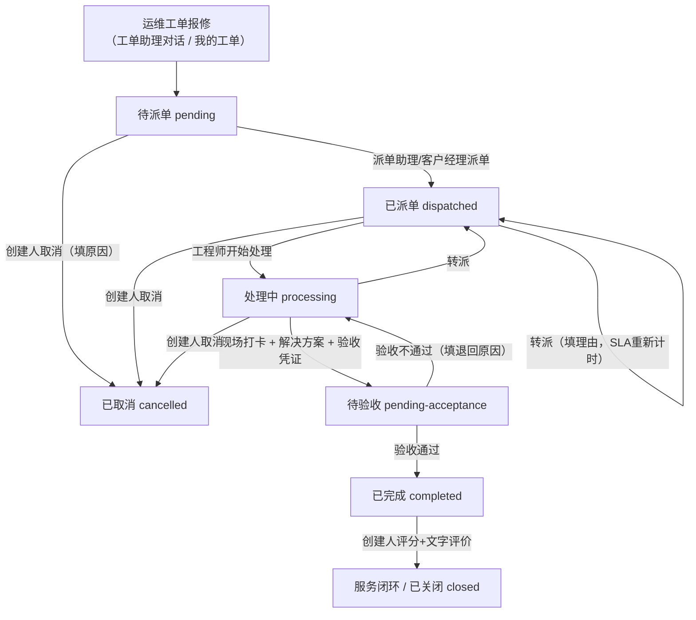

# 运维工单使用指导手册

> 版本：V1.0 ｜ 日期：2026-09-17 适用范围：工单助理数字员工 —— **运维工单**场景阅读对象：运维人员、客户经理、一线现场工程师

---

## 目录

1. [认识运维工单与工单助理](#1-认识运维工单与工单助理)
2. [角色与入口](#2-角色与入口)
3. [运维工单基础知识](#3-运维工单基础知识)
4. [如何创建运维工单（报修）](#4-如何创建运维工单报修)
5. [如何处理运维工单](#5-如何处理运维工单)
6. [响应时效与解决时效（SLA）](#6-响应时效与解决时效sla)
7. [完整状态流转图](#7-完整状态流转图)
8. [常见问题 FAQ](#8-常见问题-faq)

---

## 1. 认识运维工单与工单助理

运维工单是面向**设备售后运维**场景的服务单据，覆盖设备从**故障报修 → 智能派单 → 现场/远程处理 → 验收闭环 → 服务评价**的全过程。

本手册所述工单的**所属场景固定为「运维工单」**，由工单助理数字员工统一承接。工单助理能帮你做三件事：

- **快速报修**：通过对话引导，逐步采集设备、故障现象、复现条件、现场环境等信息，字段齐全后一键生成运维工单；
- **跟催进度**：在「我的工单」中统一查看「我创建的」和「分派给我」的工单，实时跟踪状态与 SLA 剩余时间；
- **辅助处理**：为工程师提供 AI 处理建议、标准排查步骤和预估耗时，并在超时前自动告警、自动升级。

运维工单的常见来源包括：**工单助理对话报修、售后客服、巡检告警、保养计划**。

---

## 2. 角色与入口

### 2.1 三类角色（同一人可兼任，权限叠加）

| 角色 | 职责 | 典型操作 |
| --- | --- | --- |
| **运维人员** | 设备使用方/报修方 | 发起报修、查询报修记录、验收、评价 |
| **客户经理** | 客户接口人 | 发起/跟进工单，**判定是否需要前往现场** |
| **一线现场工程师** | 工单实际处理人 | 接单、现场打卡、排查处置、填写解决方案、上传凭证 |

### 2.2 系统入口

| 入口 | 地址 | 用途 |
| --- | --- | --- |
| **工单助理对话页** | `/app/mate/employee/ticket-assistant/ticket-chat` | 对话式报修、信息采集、创建工单、查工单、检索知识库 |
| **我的工单** | `/app/mate/employee/ticket-assistant/my-tickets` | 管理「我创建的」与「分派给我」的运维工单 |
| **智能工单应用（管理端）** | `/app/mate/apps/smart-ticket` | 工单概览、工单查询、资产/运维人员管理、场景与 SLA 配置 |

> 日常报修与处理只需使用「工单助理对话页」和「我的工单」两个页面。

---

## 3. 运维工单基础知识

### 3.1 五种工单类型

| 类型 | 说明 | 是否需上门 |
| --- | --- | --- |
| **设备故障** | 设备异常或停机，需排查修复（最常见，默认类型） | 视情况，由客户经理判定 |
| **配件更换** | 故障定位为硬件损坏，需更换备件 | 通常需要 |
| **定期保养** | 按保养计划执行的预防性维护 | 需要 |
| **技术咨询** | 使用疑问、参数咨询，可远程解答 | 通常不需要 |
| **现场复测** | 对历史处理结果进行二次验证 | 需要 |

### 3.2 四个优先级

| 优先级      | 标识         | 典型场景                   |
| ----------- | ------------ | -------------------------- |
| 紧急 urgent | 红色         | 设备停机、产线中断         |
| 高 high     | 橙色         | 核心功能异常，严重影响使用 |
| 中 medium   | 蓝色（默认） | 一般故障，有替代方案       |
| 低 low      | 灰色         | 咨询、优化、计划性保养     |

> ⚠️ 优先级直接决定适用的 SLA 时效，请如实选择。随意抬高优先级会挤占紧急工单资源。

### 3.3 七种工单状态

| 状态 | 含义 | 谁在等待 |
| --- | --- | --- |
| 待派单 `pending` | 工单已创建，等待分派处理人 | 派单助理/客户经理 |
| 已派单 `dispatched` | 已指派工程师，等待接单 | 工程师 |
| 处理中 `processing` | 工程师已接单并开始处理 | 工程师处理 |
| 待验收 `pending-acceptance` | 工程师提交解决方案与凭证，等待报修方验收 | 创建人 |
| 已完成 `completed` | 验收通过，工单正常结束 | — |
| 已关闭 `closed` | 系统/管理员关闭 | — |
| 已取消 `cancelled` | 创建人主动取消（需填原因） | — |

### 3.4 工单关键字段

一张运维工单主要包含：工单编号（`WO-2026-XXXX`）、标题、类型、优先级、状态、**设备信息**（编号/名称/型号/在保状态）、**客户与联系人**、故障描述、现场附件、处理人、SLA 状态与剩余时间、解决方案、验收凭证、现场打卡记录、评价信息、完整流转时间线。

---

## 4. 如何创建运维工单（报修）

系统提供**两种报修方式**，推荐首次使用对话引导式。

### 4.1 方式一：对话引导式报修（推荐）

**路径**：进入工单助理对话页 → 直接描述现场情况（如「我们车间的打印设备出问题了」）。

工单助理会分两步引导：

**第一步：填写「报修信息采集卡」**

| 字段             | 是否必填 | 说明                                   |
| ---------------- | -------- | -------------------------------------- |
| 设备编号         | 必填     | 如 EQ-1001，用于锁定设备档案与在保信息 |
| 客户             | 必填     | 客户/项目名称                          |
| 联系人、联系电话 | 选填     | 默认带出当前用户                       |
| 故障现象         | 必填     | 一句话描述具体故障                     |
| 复现条件         | 选填     | 如「连续打印必现」「重启后偶发」       |
| 现场环境         | 选填     | 温湿度、耗材批次、周边设备等           |
| 优先级           | 必选     | 紧急/高/中/低                          |

提交采集卡后，助理会**自动匹配知识库**给出初步处置建议——部分简单问题可当场自助解决，无需建单。

**第二步：确认「工单信息卡」并提交**

信息卡自动汇总标题、类型、设备、客户、联系人、优先级和故障描述，确认后点击提交。

✅ 提交成功后：

- 系统生成工单编号，格式为 `WO-2026-XXXX`，所属场景为「运维工单」；
- 工单进入**待派单池**，来源标记为「工单助理」；
- 时间线自动记录第一条「运维工单已创建」事件。

### 4.2 方式二：「我的工单」页面直接新建

**路径**：我的工单 → 点击「新建工单」→ 右侧滑出报修抽屉。

| 字段               | 是否必填                                      |
| ------------------ | --------------------------------------------- |
| 标题               | 必填                                          |
| 工单类型           | 必填（默认「设备故障」）                      |
| 优先级             | 必填（默认「中」）                            |
| 故障描述           | 必填                                          |
| 设备编号           | 选填，选择后**自动带出**设备名称、客户与位置  |
| 客户、联系人、电话 | 选填                                          |
| 现场附件           | 选填，支持现场照片、报错截图、视频、录音、PDF |

提交后页面自动切换到「我创建的」页签，并提示「工单已创建，已进入待派单池」。

### 4.3 报修注意事项

1. **标题写清「设备 + 故障」**，如「智能打印终端 A1 连续打印出现卷曲」，便于派单规则精准命中工程师；
2. **故障描述三段式**：现象 + 复现条件 + 已尝试的操作，能显著减少工程师往返确认；
3. **附件随手拍**：设备铭牌、报错画面、故障短视频是最快的信息传递方式；
4. 紧急/高优先级工单请确保电话畅通，派单后工程师会第一时间联系；
5. 工单在**待派单/已派单/处理中**阶段，如问题已自行解决，可由创建人**取消工单**（需填写取消原因）。

---

## 5. 如何处理运维工单

### 5.1 派单（待派单 → 已派单）

- 系统按**派单规则**自动/人工指派工程师。规则支持两种派单目标：
  - **按岗位派单**：如「高级现场工程师」；
  - **按具体人员派单**：直接指定某位工程师。
- 规则匹配维度包括：设备类型、客户等级、故障级别、**设备在保状态**，并参考工程师服务区域与当前负荷。
- 派单落地后，工单进入「已派单」，SLA 计时正式开始，工程师收到通知。

### 5.2 接单与开始处理（已派单 → 处理中）

**路径**：我的工单 → 「分派给我」页签 → 找到工单 → 点击「开始处理」。

- 仅「已派单」状态可接单；接单后状态变为「处理中」，时间线记录「已接单，开始现场处理」。
- 页面顶部提供 **AI 处理建议**：按「SLA 状态 → 优先级 → 创建时间」自动排序，优先提示已超时和高优先级工单，并给出**建议处理步骤**与**预估耗时**。
- 不同工单类型有标准步骤指引，例如设备故障类：
  1. 联系客户确认现场可访问时间；
  2. 现场观察并复现故障，记录环境参数；
  3. 按「耗材 → 参数 → 机械」顺序排查定位；
  4. 处置后连续验证 30 次确认稳定；
  5. 填写处理方案与验收附件，提交完成。

### 5.3 现场作业留痕

**（1）现场决策（客户经理）**

客户经理在工单上判定「需要前往现场 / 无需前往现场」（如技术咨询可远程处理），决策人与决策时间记入时间线。

**（2）现场打卡（需上门的工单必做）**

到达现场后上传**带时间与地点水印的打卡照片**，填写地点与备注。设备故障上门、配件更换、定期保养、现场复测等类型均需打卡；纯远程咨询类工单不强制。

### 5.4 转派（已派单/处理中）

当工单不在本人技能或服务区域内时，可发起**转派**：

- 必须填写**转派理由**；
- 系统完整保留转派历史（原处理人、新处理人、操作人、理由、时间）；
- ⚠️ **转派后 SLA 重新计时**，以转派落地时间作为新的计时基准，避免后任承担前任耗时。

### 5.5 处理完成 —— 闭环三件套

**路径**：处理中工单 → 「提交处理完成」。

运维工单闭环必须同时满足三项要求，缺一不可：

| #   | 必备项           | 要求                                        |
| --- | ---------------- | ------------------------------------------- |
| 1   | **解决方案**     | 必填，文字说明故障原因与处置过程            |
| 2   | **验收凭证**     | 至少上传 1 个复测截图或视频，证明故障已消除 |
| 3   | **现场打卡记录** | 需上门的工单须有带时间地点水印的到场打卡    |

提交后工单进入**待验收**，时间线记录「提交处理完成，等待客户验收」。

### 5.6 验收（待验收 → 已完成 / 退回）

**操作人：工单创建人（运维人员/客户经理）。**

- **验收通过**：工单状态变为「已完成」；
- **验收不通过**：必须填写**退回原因**，工单退回原处理人重新处理，工程师整改后需再次提交完成。

### 5.7 评价（已完成之后）

验收通过后，创建人可对本次运维服务进行评价：

- 1–5 星评分；
- 文字反馈；
- 评价结果计入工程师服务记录与统计分析。

### 5.8 处理侧操作速查表

| 当前状态 | 可执行操作                     | 操作人                    |
| -------- | ------------------------------ | ------------------------- |
| 待派单   | 派单、取消工单                 | 派单助理/客户经理、创建人 |
| 已派单   | 开始处理、转派、取消           | 工程师、创建人            |
| 处理中   | 现场打卡、提交完成、转派、取消 | 工程师、创建人            |
| 待验收   | 验收通过、验收退回             | 创建人                    |
| 已完成   | 评价（评分+反馈）              | 创建人                    |

---

## 6. 响应时效与解决时效（SLA）

### 6.1 两个核心概念

| 指标 | 计时起点 | 计时终点 | 通俗理解 |
| --- | --- | --- | --- |
| **响应时效** | 工单派单落地（工程师收到工单） | 工程师**接单/首次响应** | 「多久有人理」 |
| **解决时效** | 派单落地（转派后以转派时间重新起算） | 工单**解决/关闭** | 「多久能修好」 |

- **响应超时**：工单在响应时效内未被领取/响应；
- **解决超时**：工单在解决时效内未被关闭/解决；
- **待派单阶段不计入工程师 SLA**：工单创建后显示「待派单」，派单落地后才开始计时。

### 6.2 时效标准（按优先级）

当前内置四档 SLA 标准，正式环境由管理员在「智能工单应用 → SLA 配置」中按**优先级 + 设备类型/客户等级/故障级别/在保状态**维护：

| 优先级      | 响应时效     | 解决时效             | 超时处置                 |
| ----------- | ------------ | -------------------- | ------------------------ |
| 紧急 urgent | **0.5 小时** | **4 小时**           | 超时自动升级至交付负责人 |
| 高 high     | **2 小时**   | **24 小时**          | 超时触发主管提醒         |
| 中 medium   | **4 小时**   | **72 小时**          | 超时标记为风险工单       |
| 低 low      | **8 小时**   | **168 小时（7 天）** | 纳入周报统计             |

### 6.3 三种 SLA 状态

工单列表与详情中通过颜色 + 文字双标识展示：

| 状态            | 含义                | 建议动作                      |
| --------------- | ------------------- | ----------------------------- |
| 正常 `normal`   | 剩余时间充足        | 按计划处理                    |
| 临期 `warning`  | 接近时效阈值        | 优先安排，避免超时            |
| 超时 `breached` | 已超出响应/解决时效 | 立即处理，系统已触发升级/告警 |

列表中同时展示 **SLA 剩余时间**（如「剩余 72 小时」），待派单工单显示「待派单」，待验收工单显示「待客户验收」。

### 6.4 超时告警机制

管理员可为「未响应」和「未解决」两个阶段分别配置告警：

- **告警延迟**：超时后多久发出（0 表示超时立即告警）。例如紧急工单未解决可配置「超时 15 分钟后告警」；
- **通知对象**：指定工程师本人、组长或交付负责人；
- **通知渠道**：站内信、邮件、企业微信，可多选；
- 紧急工单默认三渠道全开，未响应立即通知工程师，未解决超时 15 分钟升级至交付负责人。

### 6.5 SLA 特殊规则

1. **转派重新计时**：每次转派以落地时间重置计时基准（`slaResetAt`），时间线明确标注「SLA 重新计时」；
2. **验收退回不改变超时事实**：退回后重新处理期间，原超时记录仍保留在工单上，用于服务质量复盘；
3. **匹配维度**：一张工单命中哪条 SLA，取决于其优先级及设备类型、客户等级、故障级别、在保状态等维度；
4. **售后制度文件可自动解析**：管理员上传售后制度文件后，系统可自动解析生成 SLA 配置草稿，经人工复核确认后生效。

### 6.6 各角色如何配合保障时效

| 角色 | 保障响应时效 | 保障解决时效 |
| --- | --- | --- |
| 报修方（运维人员） | 报修信息一次填全（设备、现象、复现条件、电话），减少工程师确认成本 | 保持电话畅通，及时配合现场访问与验收 |
| 派单方/客户经理 | 收到待派单尽快分派，避免工单堆积在派单池；及时完成「是否上门」决策 | 关注工程师负荷，必要时及时转派；跟进超时工单协调资源 |
| 工程师 | 收到工单**先接单**（即使暂不能到场，先响应止住响应计时） | 按 AI 建议排序作业，临期/超时工单优先；无法胜任尽早转派 |

> 💡 工程师最实用的一条习惯：**收到工单先点「开始处理」**。接单动作即完成 SLA 响应，随后再安排具体到场时间。

---

## 7. 完整状态流转图

---

## 8. 常见问题 FAQ

**Q1：工单提交后还能修改内容吗？** 待派单阶段如需调整，可联系派单助理处理；已派单后关键信息不可直接修改，可在沟通后由工程师补充备注。问题已解决的，建议直接取消工单并注明原因。

**Q2：响应时效从什么时候开始算？非工作时间收到工单怎么办？** 从派单落地、工程师收到工单时开始计算。非工作时间的计时口径（如是否 7×24、是否扣除节假日）由管理员在 SLA 配置中约定，Demo 中按自然小时演示。

**Q3：工单转派后，之前耗掉的时间算谁的？** 转派后 SLA 以转派落地时间**重新计时**，转派历史全程留痕，管理端仍可看到完整耗时分布用于复盘。

**Q4：提交「处理完成」时为什么被拦截？** 闭环必须具备三件套：解决方案（必填）、至少 1 个复测截图/视频（必填）、需上门工单的现场打卡记录。缺少任一项无法提交。

**Q5：纯远程就能解决的技术咨询，也要现场打卡吗？** 不需要。现场打卡仅针对需上门的工单；客户经理会先做「是否前往现场」的决策，远程类工单不强制打卡，但解决方案与验收确认仍需完整。

**Q6：验收不通过会怎样？** 工单退回处理中状态，工程师按退回原因整改后重新提交完成，再走一次验收。

**Q7：工单超时会有什么后果？** 按 SLA 配置自动触发处置：紧急工单升级至交付负责人、高优先级通知主管、中优先级标记风险工单、低优先级纳入周报统计；同时通过站内信/邮件/企业微信通知相关人员。

**Q8：如何快速判断我该先处理哪张工单？** 在「分派给我」页签查看 AI 处理建议，系统已按「SLA 超时 > 临期 > 正常、紧急 > 高 > 中 > 低、先创建优先」排好序，并给出建议步骤和预估耗时。

**Q9：设备是否在保会影响工单处理吗？** 会。设备在保状态（在保/即将到期/已过期）是派单规则与 SLA 匹配的维度之一，选择设备编号后系统自动带出在保信息，辅助派单与服务策略判定。
