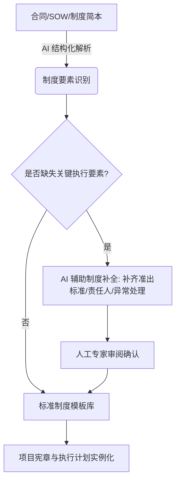

# 项目管理制度数字化与 AI 助理协同落地改造方案

> 本文保留为会议背景和历史总体方案。最新菜单、逐页需求、确认状态与开发顺序以 [项目管理 AI 助理需求与页面设计索引](./项目管理AI助理/README.md) 为准。

> **会议主题**：项目管理制度数字化与 AI 助理应用研讨会  
> **会议发言人**：Angus  
> **整理与规划部门**：PMO & 数字化协同研发组  
> **当前版本**：V1.0  
> **关联源码模块**：`apps/web-antd/src/views/app/mate/`（交付项目 PMO、项目大盘、周报填报台、个人助理）

---

## 一、 会议纪要精要与战略意图

本次研讨会确立了以 **“制度数字化补全”** 为抓手、以 **“AI 智能体驱动”** 为中枢的项目管理体系重构方案。核心战略意图如下：

```
                    ┌──────────────────────────────────────────────┐
                    │            Angus 核心战略意图矩阵             │
                    └──────────────────────┬───────────────────────┘
                                           │
         ┌───────────────────┬─────────────┴───────┬───────────────────┐
         ▼                   ▼                     ▼                   ▼
   【制度数字化】       【项目宪章】          【双轨制汇报】       【轻量任务闭环】
 制度要素结构化       项目启动前宪章化       计划内项目 (OKR+成果)   任务与项目解耦
 异常处理流程闭环     合同(SOW)+制度双核驱动   计划外任务 (临时工作量) 忽略/回复/完成三态
 AI解析与经验沉淀     成果物验收标准前置     周报催交与大盘反哺     未回任务周报提醒
```

### 1.1 会议关键决议清单

| 维度 | 传统痛点 | Angus 决议与管理定调 | 核心机制 / 工具抓手 |
| :-- | :-- | :-- | :-- |
| **制度治理** | 制度缺乏执行标准，只有宏观口号，遇到卡点或验收不通过无章可循 | **制度结构化 + 异常处理强制闭环**：每个阶段必须明确准入/准出门禁、成果物清单、责任人，且必须具备“验收不合格”与“异常变更”闭环流程 | AI 辅助制度补全、合同与制度自动化解析、经验沉淀机制 |
| **项目立项** | 边做边立项，权责不清，客户合同缺少执行细节导致扯皮 | **项目宪章（Project Charter）作为“项目宪法”**：立项必须产出宪章，补齐 RACI 矩阵、资源需求、里程碑、变更机制；合同缺少的由内部制度强行补足 | 宪章模板库、AI 自动拟定宪章初稿、人工审核定稿 |
| **过程交付** | 成果物形式主义，截图模糊、无统一格式，验收标准主观 | **成果物标准化与验收标准前置**：细化成果物规范（文档、录像、请假单截图等），并在立项及制度中明确验收标准（如“需带审批流截图而非微信文字”） | 成果物凭证库、门禁自动核验、质询单生成 |
| **工作汇报** | 周报将临时打杂与项目研发混杂，难以客观衡量产出与负荷 | **“计划内项目 + 计划外任务”双轨制**：计划内项目绑定目标 (OKR) 与成果物；计划外任务单独核算工时与协同价值 | 双轨汇报看板、OKR 成果物催交卡片、工作量热力图 |
| **协作任务** | 传统系统任务过于沉重，跨部门临时协同无处记录，下发后石沉大海 | **轻量化任务管理闭环**：任务与项目体系解耦，支持“忽略、回复、打勾完成”轻量三态互动；未回复者自动沉淀为下周周报待办 | 个人 AI 助理统一待办、跨部门协同消息链、周报自动带出 |
| **AI 助理** | 各自为战，海外 SaaS 订阅费用高昂（$70/人/月），无法本地化安全受控 | **自研/本地化个人助理 + 统一工作台**：待办、日程协调、跨系统信息聚合一体化；兼具极低成本与高扩展性 | 本地部署大模型、智能日程协调、低成本外设/硬件生态探索 |

---

## 二、 现状系统差距分析（GAP Analysis）

结合当前项目（基于 Vue 3 + Vite + TypeScript + Ant Design Vue 开发的数字员工平台），对标会议需求进行差距梳理：

```
[ 当前系统实现 ]                                         [ Angus 会议目标架构 ]
├─ templates.vue (仅有基础准入/退出门禁)      ───GAP 1───►  增加【异常变更处理】、【验收不合格流转】与【AI制度补全】
├─ project-create-wizard (仅阶段/O/KR拆解)   ───GAP 2───►  升级为【项目宪章 Project Charter】(RACI/资源/合同制度双驱动)
├─ current-report-workbench (通用周报编辑)   ───GAP 3───►  重构成【计划内项目(OKR+成果物) + 计划外任务】双轨制
└─ (暂无独立任务协同入口)                     ───GAP 4───►  打造【轻量化任务闭环】(三态互动) 与【个人AI助理统一待办】
```

---

## 三、 四大支柱落地架构设计

### 支柱 1：制度数字化与 AI 辅助补全中心

#### 1. 制度要素模型拓展

在 `templates.vue` 中，将原单一的阶段门禁扩充为包含 **“正向执行流”** 与 **“异常治理流”** 的全生命周期结构：

1. **阶段准入准出标准（Gates）**：
   - 准入依赖（前置交付物、环境准备、审批单）；
   - 准出标准（必备成果物、指标达标率、验收责任人 Sign-off）。
2. **异常处理闭环（Exception Handling）**：
   - **验收不合格（Rejection）**：整改时限要求、质询流程、是否扣减进度、责任人连带；
   - **异常变更（Change Management）**：工期超期阈值预警、容缺特批流转（Concession Advance）、范围重排（Re-scope）。
3. **AI 辅助制度补全（AI Policy Completion）**：
   - 用户上传简版合同或制度 PDF/文本，AI 自动扫描缺失的“准入门禁”、“验收不合格应对条款”，一键生成规范补全草稿。



---

### 支柱 2：项目宪章（Project Charter）驱动的立项规范

#### 1. 项目宪章的“项目宪法”地位

立项流程全面升级为《项目宪章生成向导》：

- **合同（SOW）与制度双驱动**：以客户合同确定商务边界与交付物；用内部制度补齐质量门禁、RACI 责任矩阵与汇报频次；
- **项目宪章核心构成**：
  1. **基本概述**：项目代号、商务合同编号、SOW 关键交付里程碑；
  2. **组织与责任矩阵（RACI Matrix）**：明确各阶段的 Responsible（执行）、Accountable（负责）、Consulted（咨询）、Informed（知情）；
  3. **资源需求清单**：核心团队人天预算、服务器/测试环境资源、外部采购预算；
  4. **成果物与前置验收规范**：
     - 列明各成果物交付形式（如“系统上线需提供部署脚本+冒烟测试录像”、“调休请假需提供系统审批截图而非文字说明”）；
  5. **变更与异常规程**：延期宽限期规则、容缺推进申请权限。

---

### 支柱 3：“计划内 + 计划外”双轨制汇报体系

周报填报台（`current-report-workbench.vue`）摒弃流水账式汇报，全面采用双轨制：

```
┌────────────────────────────────────────────────────────────────────────┐
│                        执行者周报工作台 (双轨制)                        │
├───────────────────────────────────┬────────────────────────────────────┤
│ 轨一：【计划内项目目标与成果物】   │ 轨二：【计划外临时任务与协同支持】  │
├───────────────────────────────────┼────────────────────────────────────┤
│ • 自动拉取当前员工所属项目的进行中阶段│ • 记录非项目类的临时事务 (售前演示、│
│ • 关联业务模块 OKR 目标推进百分比   │   紧急排障、跨部门会议、突发支持)   │
│ • 【成果物凭证提交柜】：          │ • 填写协同对象、工时投入、交付结果 │
│   - 强制上传或关联格式凭证        │ • 作为工作量饱和度与组织贡献补充   │
│   - 对照前置验收标准自查勾选      │                                    │
│ • 【卡点阻塞上报】：反哺项目大盘  │                                    │
└───────────────────────────────────┴────────────────────────────────────┘
```

#### 双向闭环逻辑：

1. **周五填报前**：AI 助理主动发送提醒：“您所属的【SAP 智能审核】项目本周有《系统集成测试用例》待提交，请注意附带审批截图”；
2. **周报提交后**：
   - 计划内提交的成果物自动进入项目大盘（`projects-workbench.vue`）的阶段成果物列表，更新对应 KR 进度；
   - 周报中上报的 Blocker 自动点亮项目阶段卡片的红黄呼吸警示灯，触发管理者的【AI 延期应对指导】；
   - 计划外任务自动归集至员工工时档案与团队协同热力图。

---

### 支柱 4：轻量化任务管理闭环与 AI 个人助理

#### 1. 任务与项目解耦

- 项目体系（OKR、Stage Gate、Charter）适合中长期、结构化的业务交付；
- 任务体系（Task）专为临时性、突发性、点对点沟通而设计，极度轻量。

#### 2. 任务交互三态机制

发起人通过自然语言或表单下达任务后，接收人无需填写复杂工单，支持即时三态操作：

- **【忽略 (Dismiss)】**：需快速标注简短原因（如“非本人职责/已有替代方案”），通知发起人；
- **【回复 (Reply)】**：快速沟通进展或补充材料，形成轻量消息流；
- **【完成 (Done)】**：一键打勾，记录闭环时间。

#### 3. 未回复任务自动联动周报

- 若某项下达任务在截止日前处于“未回复/未闭环”状态，系统在员工生成本周周报时**自动将其作为待办项注入待办清单**，并提醒员工在周报中给出响应或列入下周计划，杜绝“任务下发后石沉大海”。

#### 4. AI 个人助理（Personal Assistant）功能矩阵

- **统一待办总揽**：聚合项目催缴、协作任务、审批事项、会议通知；
- **智能日程协调**：识别团队多方日历空闲，一键匹配最优会议时段并生成会议摘要草稿；
- **低成本与安全**：本地模型推理部署，相比每人每月 70 美元的海外昂贵订阅，实现企业级私有化成本断崖式下降。

---

## 四、 页面与代码改造定义（具体实施点）

### 4.1 模板配置中心 (`templates.vue`)

- [NEW] **异常处理与变更规则配置卡片**：
  - 在每个阶段增加“准入门禁”、“准出门禁”、“异常与容缺规则（如未达标时的退回机制/特批流转审批人）”；
- [NEW] **AI 制度分析与补全按钮**：
  - 支持输入制度简本，AI 输出补全后的准入准出标准建议。

### 4.2 项目立项向导 (`project-create-wizard.vue`)

- [MODIFY] **从简单的“阶段拆分”升级为“项目宪章生成”**：
  - 第一步：基本信息与合同 SOW 关联；
  - 第二步：阶段划分与 RACI 矩阵分配（负责人、审核人、知情人）；
  - 第三步：成果物清单与前置验收标准（格式要求、凭证样例）；
  - 第四步：AI 一键生成《项目宪章（Project Charter）》完整预览，导出或归档生效。

### 4.3 项目管理工作台 (`projects-workbench.vue`)

- [ENHANCE] 阶段卡片与抽屉联动：
  - 抽屉中展示项目宪章摘要、准入准出门禁达成情况；
  - 提供“容缺特批流转”留痕审批弹窗（已支持，进一步打通宪章授权链）。

### 4.4 周报工作台 (`current-report-workbench.vue`)

- [MODIFY] 界面分栏重构为“双轨制”：
  - **左栏 / 模块一：计划内项目进度与成果物汇报**：
    - 自动载入当前负责的阶段与目标；
    - 成果物凭证上传组件（支持校验格式：截图、文档链接、测试日志）；
  - **右栏 / 模块二：计划外临时任务与工作量记录**：
    - 快速添加“临时协作/排障/售前”卡片；
    - 自动拉取个人助理中“本周未完结轻量任务”，支持一键打勾转入周报完成项。

### 4.5 个人助理与轻量任务组件 (`personal-assistant/` 或 `assistant-drawer`)

- [NEW] **轻量任务下达与交互卡片**：
  - 包含指令内容、协同人、截止时间；
  - 接收人操作条：【忽略】/【回复】/【✓ 打勾完成】；
  - 状态实时同步，逾期未回复自动打上“待周报说明”标记。

---

## 五、 数据结构定义（Schema 改造预览）

```typescript
// 1. 项目宪章核心定义
export interface ProjectCharter {
  id: string;
  projectId: string;
  contractCode?: string; // 客户合同 / SOW 编号
  sowSummary: string; // 合同交付范围摘要
  businessGoals: string[]; // 商业目标
  raciMatrix: Array<{
    stageId: string;
    stageName: string;
    responsible: string; // 执行人
    accountable: string; // 负责人 (PM)
    consulted: string[]; // 咨询人
    informed: string[]; // 知情人
  }>;
  deliverableStandards: Array<{
    // 成果物前置验收规范
    deliverableName: string;
    requiredFormat: 'document' | 'screenshot' | 'video' | 'archive' | 'link';
    acceptanceCriteria: string; // 验收标准 (如：包含钉钉审批流截图)
    verifierRole: string; // 验收人
  }>;
  resourceBudget: {
    manDays: number;
    budgetCost?: number;
    environments: string[];
  };
  changeControlRule: string; // 变更控制与容缺特批规程
  status: 'draft' | 'approved' | 'active';
  approvedAt?: string;
  approvedBy?: string;
}

// 2. 双轨制周报数据模型
export interface DualTrackWeeklyReport {
  id: string;
  userId: string;
  userName: string;
  cycle: string; // 如 "2026-W35"
  submittedAt: string;
  // 轨一：计划内项目交付
  projectTracks: Array<{
    projectId: string;
    projectName: string;
    stageId: string;
    stageName: string;
    progressContribution: number;
    submittedDeliverables: Array<{
      name: string;
      format: string;
      fileUrl: string;
      selfCheckPassed: boolean; // 是否符合前置验收标准
    }>;
    blockers: Array<{
      issue: string;
      severity: 'high' | 'medium';
      needHelpFrom: string;
    }>;
  }>;
  // 轨二：计划外临时任务
  unplannedTasks: Array<{
    id: string;
    title: string;
    category: 'presales' | 'support' | 'adhoc-meeting' | 'emergency';
    collaborator: string;
    spentHours: number;
    outcomeSummary: string;
    sourceTaskId?: string; // 若关联自轻量协同任务
  }>;
}

// 3. 轻量化协同任务模型
export interface LightweightTask {
  id: string;
  initiator: string; // 发起人
  assignee: string; // 执行人
  title: string;
  detail?: string;
  deadline: string;
  status: 'pending' | 'replied' | 'completed' | 'dismissed';
  dismissReason?: string;
  replies: Array<{
    author: string;
    content: string;
    time: string;
  }>;
  autoRemindInWeeklyReport: boolean; // 是否在未回复时转入周报提醒
  createdAt: string;
  completedAt?: string;
}
```

---

## 六、 实施演进路线图（Roadmap）

```
阶段一：制度数字化与宪章模型 (当前即刻启动)
  ├─ 完善 templates.vue 阶段异常处理闭环与门禁配置
  ├─ 升级 project-create-wizard.vue，输出《项目宪章 Project Charter》
  └─ 完善成果物前置验收规范字段与数据 Mock
      │
阶段二：双轨制周报工作台重构
  ├─ 改造 current-report-workbench.vue 支撑计划内(OKR+成果物)+计划外任务
  ├─ 实现成果物凭证自查与格式校验
  └─ 打通周报卡点向 portfolio 项目大盘的反向回写
      │
阶段三：轻量任务闭环与个人 AI 助理待办
  ├─ 实现任务与项目解耦的轻量下达组件 (三态：忽略/回复/完成)
  ├─ 实现周报自动带出未回复任务闭环机制
  └─ 个人助理端待办与日程聚合面板
      │
阶段四：AI 制度生成与生态外设拓展
  ├─ 合同与制度文本一键解析与补全
  └─ 智能日程协调算法与前沿低成本交互探索
```

---

## 七、 总结

本方案将 Angus 提出的四大核心命题转化为可落地、高内聚、闭环自洽的系统架构：

1. **让制度有手有脚**：制度不只是 Word，而是嵌入系统的门禁与异常处理引擎；
2. **让启动有规可依**：以《项目宪章》为唯一法定抓手，合同与制度双驱动；
3. **让汇报客观分流**：双轨制既守护了主干项目的目标与成果物交付，又关照了临时协同的真实工作量；
4. **让协同极度轻盈**：轻量任务三态秒级响应，未闭环自动回流入周报，配合低成本个人 AI 助理，形成完整的数字化管理闭环。
